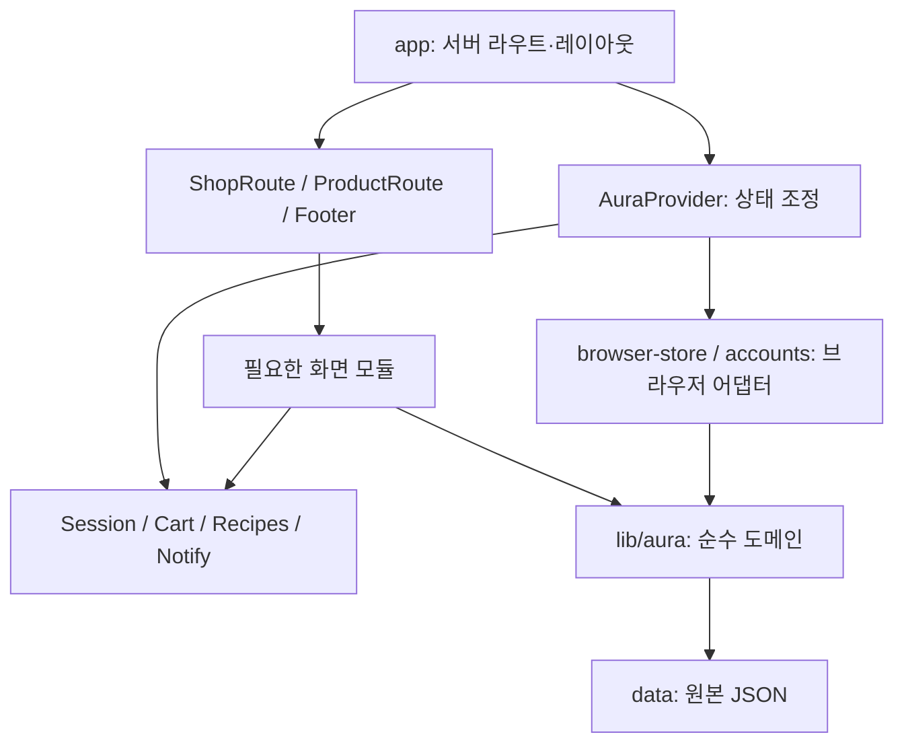

# AURA — From Scent to Identity

Next.js 16.4.2 업그레이드와 AURA 팀 전달본의 인터랙션 개선을 반영했습니다. 조향 화면은 한 작업 화면과 혼합·시향 모달로 구성했습니다. 적용 내역과 검수 범위는 [QA 기록](docs/QA_RESULTS_KO.md), 화면별 동작은 [인터랙션 적용표](docs/REFERENCE_INTERACTION_MAPPING_KO.md)를 참고하세요.

향을 발견하고, 나만의 취향을 기록하는 프래그런스 커머스와 퍼스널 아틀리에.

Next.js App Router · React · TypeScript · Tailwind CSS. 최신 통합 PRD v1.0(2026-10-12)을 기준으로 전면 정리한 프론트엔드 소스입니다.

## 실행

Node.js 20.9 이상을 사용합니다. 프로젝트 폴더에서 실행하세요.

```powershell
npm ci
npm run dev
```

브라우저에서 `http://localhost:3000`으로 접속합니다.

```powershell
npm run lint
npm run typecheck
npm test
npm run build
```

`npm run check`는 코드 린트 → CSS 구조 검사 → 타입 검사 → 도메인 회귀 테스트를 차례로 실행하며, 실패하면 중단합니다. 테스트는 기존 TypeScript와 Node.js 내장 테스트 러너를 사용하고 임시 디렉터리에서 실행 후 정리합니다. 프로덕션 빌드는 별도로 실행합니다. 현재 `next/font/google`을 사용하므로 빌드 중 Google Fonts에 접근할 수 있어야 합니다.

## 브라우저 회귀 검증

기본 명령은 Playwright의 Chromium으로 데스크톱·모바일 동작을 검증합니다. 첫 실행 전에 브라우저를 설치하고 프로덕션 빌드를 준비합니다.

```powershell
npx playwright install chromium
npm run build
npm run test:e2e
```

포트 3100에서 테스트용 서버를 자동으로 시작·종료하므로 해당 포트의 기존 서버를 먼저 종료해야 합니다. 테스트는 주요 10개 화면과 아틀리에의 이미지 비교, 메뉴·검색·선택 상자 조작, 애니메이션 정의, 향료 연속 입력 상한, 키보드·자동 혼합, 모달 닫기, 임시 저장 복원, 레시피 초기화와 센서 권한 거절·지연·신호 없음을 다룹니다. 센서 항목은 모바일 프로젝트에서 실행하며 데스크톱에서는 건너뜁니다.

스크린샷 기준 파일 `e2e/snapshots/`는 Git에서 제외하고 로컬에 보관합니다. 기본 `npm run test:e2e`는 기준 이미지가 없는 새 체크아웃에서도 실행되며, 이미지 비교가 필요한 `*layout.spec.ts`는 제외합니다. 로컬 기준 파일이 있으면 데스크톱·태블릿·모바일 화면 비교를 포함해 실행할 수 있습니다.

```powershell
npm run test:e2e:visual
```

새 기준 이미지는 `npm run test:e2e:visual -- --update-snapshots`로 현재 빌드에서 생성합니다. 의도한 디자인 변경이 있을 때 결과 이미지를 확인한 뒤 갱신합니다. 실패 시 `test-results/`에 실행 추적과 이미지 차이가 저장됩니다. 센서 테스트는 API 모의 구현을 사용하므로 실제 iPhone Safari의 센서·권한 동작도 기기에서 확인해야 합니다.

## 모바일 흔들기 확인

iPhone Safari에서 HTTPS 주소로 `/atelier`에 접속한 뒤 향료 선택 → 섞기 → `휴대폰 흔들기 켜기` 버튼으로 센서 권한을 요청합니다. 로컬 개발에서는 `cloudflared tunnel --url http://localhost:3000`으로 HTTPS 주소를 만들 수 있습니다. 터널 도메인은 개발 설정에 허용되어 있습니다.

실제 기기의 센서와 권한 동작은 별도 확인이 필요합니다. 센서가 없거나 권한을 거절하면 자동 섞기 또는 수동 젓기를 이용할 수 있습니다.

## 구현 범위

- 홈 6개 섹션, 자연 스크롤, 컬렉션 원형 카드, 소식 캐러셀, 상품 캐러셀, Atelier 스크롤 장면
- FRESH / SOFT / WARM × 10개 상품, 30개 상세 화면
- 상품 검색, 컬렉션·유형 필터, 원화 가격 정렬
- 같은 컬렉션의 서로 다른 단품 3개를 고르는 Gift Set
- 장바구니 수량·구성·새로고침 유지, 주문 정보 화면
- 회원가입·로그인·로그아웃, 신규 회원 배송비 쿠폰 표시
- 향료 24개, 반복 투입, 최대 20회, 선택 비중·블렌딩 색·비커 높이 연동
- PC 원형 드래그, 모바일 흔들기 요청 및 버튼 대체 조작
- 디지털 시향, 이름·라벨 선택, 레시피 저장·다시 만들기·버전 관리
- 마이페이지의 저장한 향·쿠폰·주문·계정 영역
- 입점 문의 폼과 필수값 검증, 미연동 상태 안내
- 향료 투명 WebP 24장, 투명 벡터 59개, 제품 목업 WebP 27장, Pretendard 웹폰트

## 구조

| 경로 | 역할 |
|---|---|
| `app/` | 얇은 서버 라우트 진입점·전역 CSS 진입점·문의 API |
| `app/globals.css`, `styles/` | Tailwind·공통 토큰·문서 기본값·공유 UI·사이트 셸·모션 |
| `components/**/*.module.css` | 홈·커머스·회원·입점·아틀리에 화면 스타일 |
| `components/commerce/ShopRoute.tsx`, `ProductRoute.tsx` | 상품 URL의 공통 서버 진입점·쿼리 정규화·404 처리 |
| `components/commerce/Shop.tsx`, `ProductDetail.tsx`, `ProductCard.tsx` | 상품 목록·상세·카드 |
| `components/commerce/Cart.tsx`, `Checkout.tsx` | 장바구니·주문 정보 화면 |
| `components/providers/AuraProvider.tsx` | 계정 전환·상태 액션·저장소 동기화 조정 |
| `components/providers/AuraContexts.ts` | 회원·장바구니·레시피·알림별 구독 계약 |
| `lib/aura/catalog.ts`, `cart.ts`, `recipes.ts`, `pricing.ts`, `format.ts`, `validation.ts` | React·Next.js·브라우저에 의존하지 않는 도메인 규칙 |
| `lib/aura/browser-store.ts` | 교체 가능한 StoragePort 기반 장바구니·레시피 저장 어댑터 |
| `lib/aura/accounts.ts` | 브라우저 계정 어댑터·비밀번호 확인·회원 정보 복원 |
| `data/catalog.json`, `ingredients.json` | 30개 상품·3개 컬렉션·24개 향료 원본 데이터 |
| `components/editorial/Shared.tsx` | 공통 시각 요소·제품 비주얼·비커·수량 조작 UI |
| `components/editorial/Shell.tsx`, `Footer.tsx` | 클라이언트 내비게이션·검색 셸과 서버 푸터 |
| `components/editorial/Home.tsx`, `Atelier.tsx`, `Account.tsx`, `Partner.tsx` | 홈·조향·회원·입점 화면 |
| `components/atelier/useComposition.ts` | 조향 상태 전환·임시 저장·저장 레시피 복원 |
| `components/atelier/useBlend.ts`, `useDeviceMotion.ts` | 혼합 모드·수동 조작·타이머·센서 권한과 리스너 생명주기 |
| `components/atelier/BlendExperience.tsx`, `content.ts` | 혼합 화면 표현·조향 UI 문구 |
| `components/atelier/Atelier.module.css` | 화면 루트에 한정된 아틀리에 스타일·로컬 애니메이션 |
| `lib/aura/atelier.ts`, `blending.ts`, `motion.ts` | 조향·혼합 상태 전이와 센서 판정의 순수 모델 |
| `lib/aura/atelier-store.ts` | 임시 조향 데이터를 위한 sessionStorage 어댑터 |
| `public/assets/products/` | 27개 단품 목업 |
| `public/assets/botanical/` | 1680×1680 투명 WebP 향료 24종 |
| `public/assets/editorial/` | 그룹별로 분리한 투명 SVG |
| `docs/` | 기준 PRD·에셋 목록·검수 기록·적용 제한 |
| `tests/`, `e2e/` | 순수 모델·저장 계약 테스트와 실제 브라우저 동작·화면 회귀 테스트 |

대표 경로: `/`, `/shop`, `/shop/[id]`, `/atelier`, `/login`, `/register`, `/cart`, `/checkout`, `/mypage`, `/partner`.

기존 `/products`, `/custom`, `/signup` 경로는 호환됩니다. 이전 `/cards`는 `/shop`으로 이동합니다. 카드·등급·포인트·Pickup 기능은 활성 소스에서 제외했습니다.

## 아키텍처 검토와 적용한 경계

화면 변경의 영향 범위를 줄이기 위해 다음 결합을 해소했습니다.

| 발견한 문제 | 변경과 효과 |
|---|---|
| `Aura.tsx`가 모든 화면을 클라이언트 진입점으로 재수출 | 집계 모듈을 제거하고 라우트가 필요한 화면을 직접 가져옵니다. 홈의 상품 카드도 상품 상세·장바구니 구현을 함께 참조하지 않습니다. |
| `Commerce.tsx` 한 파일이 목록·상세·장바구니·주문을 담당 | 화면별 모듈로 분리해 수정·검토 범위를 좁혔습니다. |
| 단일 Context에 회원·장바구니·레시피·알림이 함께 포함 | `useSession`, `useCart`, `useRecipes`, `useNotify`로 구독을 나눴습니다. Context 값과 액션을 메모화해 알림 변경만으로 다른 Context 값이 새로 생성되지 않게 했습니다. |
| Provider와 UI 폴더에 도메인·저장 처리가 혼재 | 도메인을 `lib/aura`, 데이터를 `data`로 이동하고 브라우저 저장 처리를 별도 어댑터로 분리했습니다. 테스트는 저장 포트를 주입해 브라우저 없이 실행합니다. |
| `/shop`과 `/products`에서 조회·별칭 처리가 중복 | 목록·상세 공통 서버 진입점을 사용하고, 반복 쿼리 파라미터도 화면에 전달하기 전에 정규화합니다. 기존 URL을 유지합니다. |
| 정적 푸터까지 클라이언트 셸에서 구성 | 서버 레이아웃에서 푸터를 만들어 셸의 ReactNode 슬롯으로 전달합니다. |



`app/layout.tsx`와 공통 상품 라우트는 서버 컴포넌트로 유지합니다. 클라이언트 Provider 안에 `children`으로 전달된 서버 화면과 푸터는 서버에서 구성됩니다. Context를 나누면서도 회원 전환 시 장바구니 소유자·회원·레시피를 함께 바꾸는 조정은 하나의 Provider에서 유지합니다.

의존 방향은 ESLint로 검증합니다. `lib`는 React·Next.js·UI 모듈을 가져올 수 없고, 순수 도메인 파일은 브라우저 전역 객체나 저장 어댑터를 참조할 수 없습니다. 화면은 Provider 구현 대신 Context 계약을 참조하며, 라우트·UI의 `export *`도 금지합니다. 이 규칙은 `npm run check`에 포함됩니다.

아틀리에는 `useComposition`의 reducer가 향료·이름·라벨·결과 전환을 한 번에 갱신합니다. 향료 추가는 현재 상태의 총량을 기준으로 검사하므로 연속 이벤트도 20회를 넘지 않으며, 조합을 수정하면 저장·장바구니 확인 상태가 함께 해제됩니다. 저장 레시피 URL에서 새 조합을 시작해도 원본을 다시 불러오지 않습니다.

`useBlend`는 자동 혼합 타이머와 포인터 조작을 담당하고, `useDeviceMotion`은 직접 클릭으로 권한을 요청한 뒤 필요한 동안만 센서를 구독합니다. 모달 종료·자동 모드 전환·컴포넌트 해제는 진행 중 권한 요청을 무효화합니다. 센서 판정은 유효한 수치와 반복된 피크만 혼합 진행에 반영하며, 신호가 없으면 수동·자동 혼합을 계속 사용할 수 있습니다. 실제 권한은 브라우저가 관리합니다.

버전별 전역 CSS 13개를 정리해 `app/globals.css` 하나로 공통 스타일을 불러옵니다. 홈·커머스·회원·입점·아틀리에의 화면 규칙은 CSS Modules로 분리했습니다. `:where(.root)`가 적용 범위를 한정하며, 기존 선택자의 우선순위를 높이지 않습니다. 자식의 기존 클래스는 JavaScript 조작과 공용 컴포넌트의 연결을 위해 `:global`로 유지합니다.

공통 `:is(...)` 타이포그래피와 네이티브 컨트롤은 전역으로 유지합니다. 이 규칙에 의해 덮어써지던 이전 화면 선언은 제거했고, 필요한 반응형 간격은 해당 모듈에서 명시합니다. 화면 전용 키프레임은 모듈에 두고 실제 공유되는 키프레임만 전역으로 남겼습니다. 기존 우선순위에 필요한 `!important`와 레거시 클래스까지 모두 제거한 상태는 아닙니다.

이번 변경은 의존성과 책임 분리를 검증한 것으로, 번들 크기나 렌더링 시간 개선을 측정한 결과는 아닙니다. 실제 성능 평가는 번들 분석과 React Profiler 측정을 별도로 수행해야 합니다.

## CSS 수정 위치

| 파일 | 담당 범위 |
|---|---|
| `app/globals.css` | Tailwind와 공통 스타일의 불러오기 순서 |
| `styles/tokens.css` | 색·서체·모션의 공통 CSS 변수 |
| `styles/base.css` | 문서·텍스트 요소의 기본값 |
| `styles/components.css` | 버튼·카드·폼 컨트롤·공통 타이포그래피·온보딩 |
| `styles/shell.css` | 내비게이션·검색·푸터와 문서 레이아웃 연동 |
| `styles/motion.css` | 접근성 모션 설정과 공유 키프레임 |
| `Home.module.css`, `Commerce.module.css`, `Account.module.css`, `Partner.module.css`, `Atelier.module.css` | 각 화면의 레이아웃·표현·반응형 규칙 |

화면 변경은 해당 CSS Module에서 수정합니다. 버전 번호를 붙인 보정 CSS를 추가하지 않습니다. `npm run lint:css`는 전역 진입점·공통 파일의 역할·컴포넌트의 모듈 사용을 검사하며 `npm run check`에도 포함됩니다. 선택자를 합칠 때 `:is()`의 최대 우선순위와 단축 속성의 초기화 효과를 유지해야 합니다. 디자인 변경이 없는 정리는 기존 스크린샷 기준을 갱신하지 않고 비교합니다.

## 운영 연결 및 미확정 정보

현재 저장소와 프로젝트 발제의 프론트엔드 범위에 맞게 브라우저 저장소를 사용합니다. **상용 서버 인증·DB·PG·실제 주문 생성·문의 접수 서버는 연결되지 않았습니다.**

- 비밀번호는 salt + PBKDF2 검증값으로 저장하지만, 브라우저 저장소는 서버 인증을 대체하지 않습니다. HTTPS 또는 localhost가 필요합니다. 기기 간 동기화·이메일 복구·실주문 이력은 제공하지 않습니다.
- 현재 표시 가격은 `catalog.json`에서 관리하며, Gift Set은 선택한 단품 3개의 가격을 합산합니다. 개별 상품의 가격이 `null`이거나 구성이 유효하지 않으면 가격 확인 상태로 처리합니다. 실제 판매 전 운영 가격을 최종 대조해야 합니다.
- 쿠폰의 유효기간·최소 주문금액·복원 정책은 미확정입니다. 주문 화면의 쿠폰 적용은 금액 확인 UI이며 실제 사용 처리나 주문을 생성하지 않습니다.
- Custom의 제조 가능 범위와 가격이 미확정이므로 구매를 연결하지 않습니다. 조향 비중·액체 색은 개념적인 UX 표현입니다.
- 문의 API는 입력 검증 후 HTTP 503을 반환합니다. 실제 접수 없이 완료를 표시하지 않습니다.
- Gift Set 대표 비주얼은 복구한 같은 컬렉션 단품 사진 3장으로 만든 **실제 HTML/CSS 구성**입니다. 최종 선물 포장 목업은 미확정입니다.
- 목업의 인쇄된 향 노트·효능·전성분은 제조 검증 자료가 아닙니다. 컬렉션 노트·용량·재고 등 운영 데이터는 실제 판매 전 최종 대조가 필요합니다.
- SVG는 레퍼런스 기반으로 새로 그린 편집 가능한 벡터이며, 레퍼런스 사진을 SVG로 감싼 파일이 아닙니다. 원본과 픽셀 단위로 동일한 질감은 아닙니다.

향료 이미지는 기존 420px 원본을 1680px로 재출력한 WebP이며, 원본에 없던 세부 묘사가 복원된 것은 아닙니다. 이미지 목록과 해상도는 `public/assets/botanical-manifest.json`에서 관리합니다.

## 유지보수 기준과 후속 과제

브라우저 저장소의 JSON은 신뢰하지 않고 복원 함수에서 검증합니다. 향료는 등록된 ID와 정수 수량만 허용하며 총 1~20회여야 합니다. 손상된 레시피와 장바구니 행은 제외하고, 상품 정보는 현재 카탈로그에서 다시 읽습니다. 기존 저장소 키는 유지합니다.

새 도메인 로직은 `lib/aura`의 순수 모듈에 두고 `tests/`에서 검증합니다. Provider는 상태와 저장소 동기화를 담당합니다. 회원을 바꾸면 해당 회원의 장바구니와 레시피를 함께 교체하며, 다른 탭에서 변경한 레시피도 저장소 이벤트로 반영합니다. 브라우저 저장소에는 원자적인 다중 탭 트랜잭션이 없으므로 동시 쓰기 충돌은 서버 저장소 도입 시 해결해야 합니다.

다음 정리 우선순위는 아래와 같습니다.

1. 서버 인증·DB·주문·결제·문의 접수 연결: 현재는 브라우저 기반 시연 기능이며, 운영 연동이 먼저 필요합니다.
2. 스타일 후속 정리: 화면 모듈 안에 남은 이전 UI 선택자의 실제 사용 여부를 검토하고, 공용 시각 컴포넌트도 점진적으로 모듈화합니다. `!important`는 우선순위 의존성을 확인한 뒤 줄입니다. 전역 보정 파일 13개는 공통 스타일과 화면 모듈로 통합했습니다.
3. 남은 화면 책임 분리: `Account.tsx`의 인증·회원 화면과 아틀리에의 선택·결과 표현을 더 작은 화면 컴포넌트로 정리합니다. 센서·조향 상태·혼합 표현은 별도로 분리했고 해당 흐름에 브라우저 테스트를 추가했습니다.
4. 실행·검증 구조 정리: 외부 폰트 다운로드 의존성을 검토하고 CI에 `npm run check`와 `npm run build`를 연결합니다. 제한된 실행 환경에서 Turbopack의 내부 포트 생성이 차단되면 `npm run build -- --webpack`으로 검증합니다. Context 구독 분리·회원 전환의 브라우저 검증과 실제 기기의 센서 검증은 추가해야 합니다.

기획 원문은 [PRD.md](PRD.md)에, 최근 적용·검수 기록은 [docs/QA_RESULTS_KO.md](docs/QA_RESULTS_KO.md)에 있습니다. `docs`의 날짜가 붙은 이전 문서는 당시 구현·검수 이력입니다.
