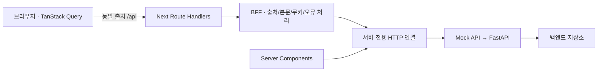

# FastAPI 연결을 위한 BFF 계약

[문서 목록](README.md) · [웹 개발 안내](../apps/web/README.md) · [API 개발 안내](../apps/api/README.md)

장바구니는 브라우저 로컬 스토리지에 저장하며 로그인·로그아웃과 관계없이 같은 브라우저에서 유지합니다. 그 외 서버 데이터는 Next.js BFF를 통해 독립 Mock API에 연결되어 있습니다. FastAPI 기본 앱은 `apps/api`에 있으며 현재 헬스 체크만 제공합니다. 업무 API·DB·운영 인증은 아직 구현하지 않았습니다. 아래 계약은 현재 화면을 유지하면서 FastAPI로 전환하기 위한 연결 기준입니다.

## 경계



- `apps/web/src/app/api/**/route.ts`: 공개할 경로와 메서드를 명시합니다. 포괄적인 catch-all 프록시나 rewrite를 사용하지 않습니다.
- `apps/web/src/server/bff`: 요청 출처·JSON 본문·세션 쿠키·브라우저 응답을 처리합니다.
- `apps/web/src/server/backend`: 서버 환경 설정과 백엔드 HTTP 요청·제한시간·오류 해석을 담당합니다.
- `apps/web/src/lib/api/client.ts`: 브라우저는 기존 `/api` 계약만 사용합니다.
- `apps/web/src/lib/api/server.ts`: Server Components는 같은 서버 전용 연결로 데이터 원본을 직접 조회합니다. Next Route Handler를 HTTP로 재호출하지 않습니다.
- FastAPI: 인증·인가·가격·재고·레시피 버전·트랜잭션과 DB를 담당합니다. BFF의 출처 검사나 `X-Session-Owner`를 인증으로 간주하지 않습니다.

장바구니 추가·수량 변경·삭제는 브라우저에서 처리하고 장바구니 API를 공개하지 않습니다. 브라우저 저장 키는 `aura_cart_v1`이며 상품 ID·수량·선택 구성만 저장합니다. 가격·상품 정보는 현재 카탈로그로 복원하고, 새로고침과 같은 출처의 다른 탭에서도 유지합니다. 기존 서버 장바구니는 자동 이전하지 않습니다.

BFF는 요청 사이에 사용자 상태를 메모리로 보관하지 않습니다. 현재 응답 DTO는 프런트에 필요한 공개 필드만 담는 계약이며, FastAPI의 `response_model`에서도 이를 제한해야 합니다. 실제 API의 필드가 달라지면 BFF의 리소스별 어댑터에서 변환하고 화면·훅까지 백엔드 형식을 전파하지 않습니다.

## 실행 환경

모든 변수는 Next 서버 전용이며 브라우저 번들에 포함하지 않습니다.

| 변수                 | 기본값                  | 용도                                                           |
| -------------------- | ----------------------- | -------------------------------------------------------------- |
| `API_URL`            | `http://127.0.0.1:4000` | 백엔드 주소. 내부 네트워크 주소 사용 가능                      |
| `API_PREFIX`         | `/api`                  | 백엔드 API 접두사. FastAPI 예: `/api/v1`                       |
| `API_TIMEOUT_MS`     | `10000`                 | 헤더 수신부터 JSON 본문 읽기까지의 제한시간. 1~60000ms         |
| `API_SESSION_COOKIE` | `aura_mock_session`     | 전달을 허용하는 백엔드 세션 쿠키 한 개의 이름                  |
| `APP_ORIGIN`         | 요청 URL의 origin       | 브라우저의 정식 공개 origin. 프록시·HTTPS 종료 환경에서는 명시 |

FastAPI가 아래 계약을 제공하는 경우의 `apps/web/.env.local` 예:

```dotenv
API_URL=http://127.0.0.1:8000
API_PREFIX=/api/v1
API_TIMEOUT_MS=10000
API_SESSION_COOKIE=aura_session
APP_ORIGIN=http://localhost:3000
```

`npm run setup:api` 후 `npm run dev:api`로 FastAPI를 실행할 수 있습니다. 현재 제공하는 경로는 `/health`와 `/api/v1/health`이며 아래 업무 계약의 구현이 끝난 후 Next를 연결합니다. FastAPI를 실행한 뒤 `npm run dev:web`으로 Next 서버를 실행합니다. Mock을 함께 쓰는 기본 개발은 `npm run dev`입니다. 프로덕션 Next 서버만 실행하려면 `npm run build` 후 `npm start`를 사용합니다.

서버 설정은 요청 시점에 읽습니다. 따라서 같은 Next 빌드에 다른 백엔드 환경 변수를 주입할 수 있습니다. `.env.local` 파일 변경 후에는 Next 서버를 재시작합니다. `API_URL`에는 프로토콜·호스트 및 필요한 배포 기본 경로를, `API_PREFIX`에는 API 접두사를 둡니다. 접두사가 없다면 `/`로 설정합니다. 브라우저의 쿼리·본문·헤더로 목적지 호스트나 경로를 선택할 수 없습니다.

## FastAPI가 제공할 리소스

공개 BFF 경로의 `/api` 부분이 백엔드에서는 `API_PREFIX`로 바뀝니다. 예: `/api/catalog` → FastAPI `/api/v1/catalog`. 경로 끝에 `/`를 추가하지 않습니다. FastAPI의 trailing-slash redirect를 포함한 백엔드 3xx는 따라가지 않고 502로 처리합니다.

| 메서드 | BFF 경로                     | 요청 / 성공 응답                                                                                  |
| ------ | ---------------------------- | ------------------------------------------------------------------------------------------------- |
| GET    | `/api/catalog`               | `Catalog`                                                                                         |
| GET    | `/api/catalog/products/{id}` | `Product`, 없는 상품은 404                                                                        |
| GET    | `/api/session`               | `Session { user: Member \| null, guestId: string }`                                               |
| POST   | `/api/auth/register`         | `{ name, email, password, marketing? }` → 201 `Session`                                           |
| POST   | `/api/auth/login`            | `{ email, password }` → `Session`                                                                 |
| POST   | `/api/auth/logout`           | 본문 없음 → `Session`                                                                             |
| GET    | `/api/recipes`               | `Recipe[]`                                                                                        |
| POST   | `/api/recipes`               | `{ name, label, counts, parent? }` → 201 `Recipe`                                                 |
| DELETE | `/api/recipes/{id}`          | `Recipe[]`                                                                                        |
| GET    | `/api/atelier/draft`         | `AtelierDraft \| null`                                                                            |
| PUT    | `/api/atelier/draft`         | `AtelierDraft` → `AtelierDraft`                                                                   |
| DELETE | `/api/atelier/draft`         | `null` 또는 본문 없는 204                                                                         |
| GET    | `/api/orders`                | 회원의 `Order[]`                                                                                  |
| POST   | `/api/orders`                | `{ recipient, address, coupon?, items: OrderItemInput[] }` → 201 `Order`; 현재 화면 결제는 비활성 |
| POST   | `/api/partner`               | `{ brand, name, email, introduction, message, type, consent, website? }` → 201 `{ id }`           |

JSON 필드는 현재 공개 DTO의 camelCase를 유지합니다. Pydantic 내부 이름은 snake_case를 사용할 수 있으나 요청과 응답의 JSON 별칭을 계약에 맞춰야 합니다. 정의 위치:

- [상품·컬렉션·향료·프로모션·추천 이름](../apps/web/src/features/catalog/model/catalog.ts)
- [회원·세션·인증 입력](../apps/web/src/features/account/model/account.ts)
- [장바구니·맞춤 조향 구성](../apps/web/src/features/cart/model/cart.ts)
- [레시피·초안](../apps/web/src/features/atelier/model/recipes.ts)
- [주문](../apps/web/src/features/checkout/model/order.ts)

주문 항목 `OrderItemInput`은 `{ productId?, quantity, selection?, custom? }`이며 각 항목에 상품 ID 또는 맞춤 조향 구성 중 하나를 전송합니다. `quantity`는 필수 정수이며 1~15입니다. 동일 항목은 합산하며 15개 초과를 거절합니다. 맞춤 조향의 `counts`는 향료 ID에 대한 정수 수량입니다. 서버가 가격·구성·수량·재고·소유권을 다시 검증하고 ID·버전·생성 시각을 결정해야 합니다. 주문 응답의 상품에는 서버가 계산한 `unitPrice`를 포함합니다. 로컬 가격·상품 객체·주문 합계를 신뢰하지 않습니다. 문의의 `consent`는 현재 폼 계약인 `"on"`입니다. 날짜는 ISO 8601 문자열, 가격은 원 단위 숫자 또는 미확정일 때 `null`입니다.

현재 공개 API에는 쿼리 매개변수가 필요하지 않아 BFF가 전달하지 않습니다. 페이지네이션·필터 등을 서버로 옮길 때는 해당 Route Handler에 허용할 매개변수와 변환을 명시적으로 추가합니다. FastAPI `/docs`·`/openapi.json`·테스트 시드 경로를 BFF에 공개하지 않습니다.

## 세션

현재 준비한 인증 연결은 불투명한 세션 쿠키 방식입니다. FastAPI는 설정한 이름으로 `Set-Cookie`를 발행하고 세션 조회·로그인·로그아웃 결과를 위 `Session` DTO로 반환해야 합니다.

- 브라우저에서 받은 쿠키 중 `API_SESSION_COOKIE`만 백엔드에 전달합니다. 브라우저의 `Authorization`, 임의 사용자 ID, `X-Forwarded-*`는 전달하지 않습니다.
- 응답에서도 허용한 쿠키만 전달합니다. 백엔드 `Domain`과 `Path`를 제거하고 BFF 호스트의 `Path=/`, `HttpOnly`, `SameSite=Lax`를 적용합니다. 공개 origin이 HTTPS이면 `Secure`도 적용합니다.
- `Expires`·`Max-Age`를 보존해 회전·만료·로그아웃 삭제를 지원합니다. 401 응답에서 세션 삭제를 보내는 경우도 전달합니다.
- 회원과 익명 방문자를 구분하고, 로그인·로그아웃 중에도 `guestId`를 유지해야 현재 방문자 조향 초안 정책을 보존할 수 있습니다.
- `X-Session-Owner`는 계정 변경 중 시작한 레시피 요청을 거절하기 위한 보조 값입니다. 쿠키로 확인한 실제 소유자와 다르면 409를 반환합니다. 소유권을 이 헤더로 결정하면 안 됩니다.

JWT·OAuth를 선택할 경우에는 토큰 발급·갱신·폐기와 서버 세션 저장 방식을 별도로 결정한 뒤 BFF 인증 어댑터에 구현합니다. 현재 코드에 Bearer 토큰을 브라우저 저장소에 넣는 임시 흐름은 추가하지 않았습니다.

변경 요청에는 동일 출처 `Origin` 또는 출처 헤더 없는 서버 API 호출을 허용하고, 다른 `Origin`과 `Sec-Fetch-Site: cross-site`는 403으로 차단합니다. `APP_ORIGIN`을 실제 공개 주소로 설정하며 클라이언트가 보낸 forwarded host로 허용 출처를 바꾸지 않습니다.

## 오류·전송 계약

BFF는 성공 시 기존 DTO를 유지하고 오류를 다음 형태로 반환합니다.

```json
{ "error": { "code": "VALIDATION_ERROR", "message": "입력 항목을 확인해 주세요." } }
```

- FastAPI `HTTPException`의 `detail: string` 또는 `detail: { message }`와 Mock의 `error.message`는 같은 프런트 오류 형식으로 변환합니다.
- FastAPI 422의 `detail[]`는 입력값·비밀번호를 포함할 수 있어 브라우저로 전달하지 않습니다. `VALIDATION_ERROR`의 일반 안내를 반환합니다.
- 백엔드 4xx의 상태는 보존합니다. 5xx·연결 실패·3xx는 502, 제한시간 초과는 504, 잘못된 JSON·비 JSON 응답은 502입니다. 내부 예외나 백엔드 HTML을 노출하지 않습니다.
- 정상 삭제의 204를 지원합니다. 그 외 응답은 `application/json` 또는 `application/*+json`이어야 합니다.
- 요청 JSON은 객체만 허용하고 최대 32KiB입니다. 잘못된 JSON은 400, 비 JSON 본문은 415, 초과 본문은 413입니다. 실제 읽은 바이트도 제한하므로 잘못된 Content-Length로 우회할 수 없습니다.
- BFF가 만든 `X-Request-ID`를 백엔드 요청과 브라우저 응답에 함께 넣습니다. 브라우저가 보낸 요청 ID는 신뢰하지 않습니다.
- 응답은 `Cache-Control: private, no-store`이며 세션 경로에는 `Vary: Cookie`를 적용합니다. 공용 카탈로그만 프런트 쿼리 캐시에 유지합니다.
- 쓰기 요청을 자동 재시도하지 않습니다. 중복 주문 방지를 위한 idempotency 계약은 실제 주문·결제 연결 시 FastAPI와 함께 정해야 합니다.

## Mock으로 먼저 검증하는 계약

Mock API는 본문이 필요한 경로에서 JSON 객체를 검사하고, 누락·잘못된 JSON·배열은 400, 비 JSON 본문은 415, 32KiB 초과는 413을 반환합니다. 오류 메시지에 파서가 읽은 입력값을 노출하지 않습니다. 로그아웃과 삭제는 본문 없이 호출할 수 있습니다.

로컬 장바구니는 상품 ID와 맞춤 조향 중 하나만 허용하고, 향료 구성으로 표시 색을 계산합니다. 항목 추가와 수량 변경 시 누적 수량 15개 상한, 단품과 Gift Set 구성품의 합산 재고를 검사합니다. 이는 화면의 사전 검증이며 주문 API는 `items`의 모든 항목을 서버 카탈로그로 다시 구성하고 가격·구성·수량·재고를 검증합니다. 거절된 주문은 주문 목록과 쿠폰을 변경하지 않습니다. 주문 응답에는 서버가 계산한 `unitPrice`를 포함합니다. 향후 주문 UI 연결 시 성공 응답을 확인한 뒤 로컬 장바구니를 비웁니다. 현재 결제 버튼은 비활성 상태입니다.

Mock 주문의 재고 검사는 전달된 전체 주문 항목과 고정 fixture를 기준으로 합니다. 사용자 간 재고 예약·차감과 운영 트랜잭션은 FastAPI·DB 구현에서 검증해야 합니다. 계정 변경으로 회원가입이 거절된 경우에도 계정이 생성되지 않는지 HTTP 테스트로 확인합니다.

실제 Mock HTTP 서버를 사용하는 통합 테스트와 Next 프로덕션 서버를 통과하는 BFF E2E로 이 계약을 검증합니다. FastAPI 전환 전에도 세션의 `guestId` 유지, 로그인·로그아웃 후 로컬 장바구니 유지, 레시피·초안·주문 흐름을 같은 공개 경로로 확인할 수 있습니다.

## OpenAPI 인계

FastAPI 구현 시 `/openapi.json`을 요청·응답 계약의 원본으로 확정합니다. 위 DTO와 차이가 있다면 서버 응답 모델 또는 BFF 리소스 어댑터로 맞춥니다. 확정한 스키마를 버전 관리하고 TypeScript 타입 생성·CI 계약 검사에 연결하는 것이 다음 단계입니다. 현재 FastAPI `/openapi.json`에는 헬스 체크만 포함되어 있습니다. 업무 API의 스키마와 생성된 TypeScript 타입은 계약 구현 후 추가합니다.

BFF HTTP 통합 테스트는 실제 서버 응답으로 FastAPI 형태의 오류·쿠키·제한시간·리다이렉트·헤더 경계를 검증합니다. Playwright는 Mock 백엔드에 연결한 실제 Next 프로덕션 서버를 통해 세션·인증·장바구니·초안과 BFF 경로를 검증합니다. FastAPI가 준비되면 같은 계약 검증을 해당 서버에서도 실행하고 DB 트랜잭션·운영 인증을 추가 검증해야 합니다.

참고: [Next.js BFF](https://nextjs.org/docs/app/guides/backend-for-frontend), [FastAPI 오류 처리](https://fastapi.tiangolo.com/tutorial/handling-errors/), [응답 쿠키](https://fastapi.tiangolo.com/advanced/response-cookies/), [프록시 뒤의 FastAPI](https://fastapi.tiangolo.com/advanced/behind-a-proxy/).
