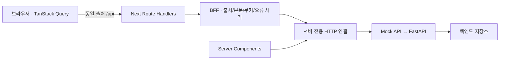

# FastAPI 연결을 위한 BFF 계약

[문서 목록](README.md) · [웹 개발 안내](../apps/web/README.md) · [API 개발 안내](../apps/api/README.md)

장바구니는 브라우저 로컬 스토리지에 저장하며 로그인·로그아웃과 관계없이 같은 브라우저에서 유지합니다. 그 외 서버 데이터는 Next.js BFF를 통해 기본적으로 독립 Mock API에 연결됩니다.

Mock과 FastAPI의 사용자 인증은 JWT로 통일합니다. FastAPI가 Access JWT를 발급·검증하고 BFF는 토큰을 HttpOnly 쿠키에 보관해 Bearer 헤더로 전달합니다. 서버 세션 ID·세션 저장소·`/session` API는 사용하지 않습니다.

회원가입·로그인·사용자 조회·Refresh 회전·로그아웃을 같은 계약으로 연결합니다. 브라우저에 반환하는 `AccountState { user, guestId }`는 화면 데이터이며 인증 자격 증명이 아닙니다. 운영 DB 마이그레이션·환경 설정과 실제 배포 검증은 환경별로 수행해야 합니다.

## 경계



- `apps/web/src/app/api/**/route.ts`: 공개할 경로와 메서드를 명시합니다. 포괄적인 catch-all 프록시나 rewrite를 사용하지 않습니다.
- `apps/web/src/server/bff`: 요청 출처·JSON 본문·토큰 쿠키·브라우저 응답을 처리합니다.
- `apps/web/src/server/backend`: 서버 환경 설정과 백엔드 HTTP 요청·제한시간·오류 해석을 담당합니다.
- `apps/web/src/lib/api/client.ts`: 브라우저는 기존 `/api` 계약만 사용합니다.
- `apps/web/src/lib/api/server.ts`: Server Components는 같은 서버 전용 연결로 데이터 원본을 직접 조회합니다. Next Route Handler를 HTTP로 재호출하지 않습니다.
- FastAPI: 인증·인가·가격·재고·레시피 버전·트랜잭션과 DB를 담당합니다. BFF의 출처 검사나 `X-Account-Owner`를 인증으로 간주하지 않습니다.

장바구니 추가·수량 변경·삭제는 브라우저에서 처리하고 장바구니 API를 공개하지 않습니다. 브라우저 저장 키는 `aura_cart_v1`이며 상품 ID·수량·선택 구성만 저장합니다. 가격·상품 정보는 현재 카탈로그로 복원하고, 새로고침과 같은 출처의 다른 탭에서도 유지합니다. 기존 서버 장바구니는 자동 이전하지 않습니다.

BFF는 요청 사이에 사용자 상태를 메모리로 보관하지 않습니다. 현재 응답 DTO는 프런트에 필요한 공개 필드만 담는 계약이며, FastAPI의 `response_model`에서도 이를 제한해야 합니다. 실제 API의 필드가 달라지면 BFF의 리소스별 어댑터에서 변환하고 화면·훅까지 백엔드 형식을 전파하지 않습니다.

카탈로그·상품·레시피·문의 접수 응답은 [공통 리소스 어댑터](../apps/web/src/server/backend/storefront.ts)로 검증하고 공개 필드만 반환합니다. 카탈로그의 중첩 DTO, 미정 가격 `null`, 선택 필드 생략, 레시피의 `parent`·`created`를 유지합니다. 구조·타입이 계약과 다르면 내용을 노출하지 않고 502로 처리합니다. 카탈로그 RSC 조회도 같은 어댑터를 사용합니다.

문의 POST는 `brand, name, email, introduction, message, type, consent, website`, 레시피 POST는 `name, label, counts, parent`만 전달합니다. 클라이언트의 소유자 ID·버전·생성 시각·계산 색·문의 처리 상태는 전달하지 않습니다. 본문 형식·크기 제한은 BFF가 검사하고 업무 검증·권한·계산은 FastAPI가 담당합니다.

## 현재 FastAPI 연결 범위

| 경로                                                                         | 현재 상태                                                     |
| ---------------------------------------------------------------------------- | ------------------------------------------------------------- |
| `/catalog`, `/catalog/products/{id}`, `/partner`, `/recipes`                 | 실제 라우터·공개 DTO 연결                                     |
| `/auth/register`, `/auth/login`, `/auth/me`, `/auth/refresh`, `/auth/logout` | JWT 인증 연결. PostgreSQL 인증 저장소 사용                    |
| `/orders`                                                                    | 회원 주문 API·중복 방지 키·공개 DTO 연결, 웹 결제 버튼 비활성 |
| `/admin/**`                                                                  | 별도 관리자 JWT 인증·등록·업무 API·공개 DTO 연결              |
| `/atelier/draft`                                                             | 방문자별 조회·전체 저장·삭제, FastAPI·공개 DTO 연결           |

`API_URL`은 한 백엔드를 선택합니다. FastAPI 오류나 미구현 경로를 Mock으로 자동 우회하지 않습니다. 웹 개발의 기본값은 Mock입니다. FastAPI 사용 시 인증 DB 마이그레이션 0003까지 적용·시드를 적용하고 JWT 발급자·서명 키·DB·BFF 공유 키를 설정합니다. 미설정 저장소를 성공으로 간주하지 않습니다.

## 실행 환경

모든 변수는 Next 서버 전용이며 브라우저 번들에 포함하지 않습니다.

| 변수                      | 기본값                  | 용도                                                                                 |
| ------------------------- | ----------------------- | ------------------------------------------------------------------------------------ |
| `API_URL`                 | `http://127.0.0.1:4000` | 백엔드 주소. 내부 네트워크 주소 사용 가능                                            |
| `API_PREFIX`              | `/api`                  | 백엔드 API 접두사. FastAPI 예: `/api/v1`                                             |
| `API_TIMEOUT_MS`          | `10000`                 | 헤더 수신부터 JSON 본문 읽기까지의 제한시간. 1~60000ms                               |
| `API_ACCESS_COOKIE`       | `aura_access`           | Access JWT를 보관하는 HttpOnly 쿠키 이름                                             |
| `API_ADMIN_ACCESS_COOKIE` | `aura_admin_access`     | 관리자 Access JWT 전용 HttpOnly 쿠키 이름                                            |
| `API_REFRESH_COOKIE`      | `aura_refresh`          | Refresh Token을 보관하는 HttpOnly 쿠키 이름                                          |
| `API_AUTH_MODE`           | 미설정                  | 선택적으로 `jwt`만 허용. 이전 `cookie` 값은 설정 오류                                |
| `API_BFF_SHARED_KEY`      | 미설정                  | FastAPI `AURA_BFF_SHARED_KEY`와 같은 서버 전용 공유 키. 변경 요청의 CSRF 경계에 사용 |
| `APP_ORIGIN`              | 요청 URL의 origin       | 브라우저의 정식 공개 origin. 프록시·HTTPS 종료 환경에서는 명시                       |

FastAPI에 연결할 때의 `apps/web/.env.local` 예:

```dotenv
API_URL=http://127.0.0.1:8000
API_PREFIX=/api/v1
API_TIMEOUT_MS=10000
API_ACCESS_COOKIE=aura_access
API_REFRESH_COOKIE=aura_refresh
# API_BFF_SHARED_KEY=<FastAPI AURA_BFF_SHARED_KEY와 같은 무작위 서버 비밀값>
APP_ORIGIN=http://localhost:3000
```

`npm run setup:api` 후 [API 안내](../apps/api/README.md)에 따라 DB 마이그레이션·시드를 적용하고 `npm run dev:api`로 FastAPI를 실행합니다. 위 환경 변수로 Next를 설정하고 `npm run dev:web`으로 웹 서버를 실행합니다. 변경 요청에는 Next의 `API_BFF_SHARED_KEY`와 FastAPI의 `AURA_BFF_SHARED_KEY`에 같은 서버 비밀값이 필요합니다. Mock을 함께 쓰는 기본 개발은 `npm run dev`입니다. 프로덕션 Next 서버만 실행하려면 `npm run build` 후 `npm start`를 사용합니다.

Docker Compose는 JWT 전송 모드를 사용하고 루트 `.env`의 `AURA_BFF_SHARED_KEY`를 Next·FastAPI 양쪽에 주입합니다. [환경 예제](../.env.example)의 DB 설정 외에 `openssl rand -hex 32`로 만든 공유 키와 실제 `APP_ORIGIN`을 지정해야 합니다. 기본 origin은 직접 로컬 접속용 `http://localhost:13000`이며 Caddy·HTTPS 환경에서는 공개 주소로 바꿉니다. 필수 설정이 비어 있으면 Compose가 시작을 거절합니다. Compose는 FastAPI에 `AURA_JWT_SIGNING_KEY`, `AURA_JWT_ISSUER`, `AURA_JWT_AUDIENCE`도 필수로 주입합니다. JWT 키와 BFF 공유 키는 별도로 생성합니다.

서버 설정은 요청 시점에 읽습니다. 따라서 같은 Next 빌드에 다른 백엔드 환경 변수를 주입할 수 있습니다. `.env.local` 파일 변경 후에는 Next 서버를 재시작합니다. `API_URL`에는 프로토콜·호스트 및 필요한 배포 기본 경로를, `API_PREFIX`에는 API 접두사를 둡니다. 접두사가 없다면 `/`로 설정합니다. 브라우저의 쿼리·본문·헤더로 목적지 호스트나 경로를 선택할 수 없습니다.

## FastAPI가 제공할 리소스

FastAPI 내부 인증 응답은 TokenPair 또는 회원 프로필이며, BFF가 브라우저용 응답과 토큰 쿠키를 구성합니다. [JWT 생명주기](backend/JWT_LIFECYCLE.md)를 함께 참고합니다.

공개 BFF 경로의 `/api` 부분이 백엔드에서는 `API_PREFIX`로 바뀝니다. 예: `/api/catalog` → FastAPI `/api/v1/catalog`. 경로 끝에 `/`를 추가하지 않습니다. FastAPI의 trailing-slash redirect를 포함한 백엔드 3xx는 따라가지 않고 502로 처리합니다.

| 메서드 | BFF 경로                     | 요청 / 성공 응답                                                                                  |
| ------ | ---------------------------- | ------------------------------------------------------------------------------------------------- |
| GET    | `/api/catalog`               | `Catalog`                                                                                         |
| GET    | `/api/catalog/products/{id}` | `Product`, 없는 상품은 404                                                                        |
| GET    | `/api/auth/me`               | `AccountState { user: Member \| null, guestId: string }`                                          |
| PATCH  | `/api/auth/me`               | `{ name?, marketing? }` → `AccountState`                                                          |
| POST   | `/api/auth/change-password`  | `{ currentPassword, newPassword }` → 204, 회원 쿠키 삭제                                          |
| DELETE | `/api/auth/me`               | `{ currentPassword }` → 204, 탈퇴 신청(30일 유예) 후 회원 쿠키 삭제                               |
| POST   | `/api/auth/register`         | `{ name, email, password, marketing? }` → 201 `AccountState`                                      |
| POST   | `/api/auth/login`            | `{ email, password }` → `AccountState`, 유예 중 계정 복구, 연속 실패 시 429 `LOGIN_LOCKED`        |
| POST   | `/api/auth/logout`           | 본문 없음 → `AccountState`                                                                        |
| POST   | `/api/auth/refresh`          | 본문 없음 → 204, 토큰 쿠키 회전                                                                   |
| GET    | `/api/recipes`               | `Recipe[]`                                                                                        |
| POST   | `/api/recipes`               | `{ name, label, counts, parent? }` → 201 `Recipe`                                                 |
| DELETE | `/api/recipes/{id}`          | `Recipe[]`                                                                                        |
| GET    | `/api/atelier/draft`         | `AtelierDraft \| null`                                                                            |
| PUT    | `/api/atelier/draft`         | `AtelierDraft` → `AtelierDraft`                                                                   |
| DELETE | `/api/atelier/draft`         | `null` 또는 본문 없는 204                                                                         |
| GET    | `/api/orders`                | 회원의 `Order[]`                                                                                  |
| POST   | `/api/orders`                | `{ recipient, address, coupon?, items: OrderItemInput[] }` → 201 `Order`; 현재 화면 결제는 비활성 |
| POST   | `/api/partner`               | 문의 저장 → 201 `{ id }`; 이메일별 10분 3건을 넘으면 429 `INQUIRY_RATE_LIMITED`                   |

JSON 필드는 현재 공개 DTO의 camelCase를 유지합니다. Pydantic 내부 이름은 snake_case를 사용할 수 있으나 요청과 응답의 JSON 별칭을 계약에 맞춰야 합니다. 정의 위치:

- [상품·컬렉션·향료·프로모션·추천 이름](../apps/web/src/features/catalog/model/catalog.ts)
- [회원·화면 상태·인증 입력](../apps/web/src/features/account/model/account.ts)
- [장바구니·맞춤 조향 구성](../apps/web/src/features/cart/model/cart.ts)
- [레시피·초안](../apps/web/src/features/atelier/model/recipes.ts)
- [주문](../apps/web/src/features/checkout/model/order.ts)

주문 항목 `OrderItemInput`은 `{ productId?, quantity, selection?, custom? }`이며 각 항목에 상품 ID 또는 맞춤 조향 구성 중 하나를 전송합니다. `quantity`는 필수 정수이며 1~15입니다. 동일 항목은 합산하며 15개 초과를 거절합니다. 맞춤 조향의 `counts`는 향료 ID에 대한 정수 수량입니다. 서버가 가격·구성·수량·재고·소유권을 다시 검증하고 ID·버전·생성 시각을 결정해야 합니다. 주문 응답의 상품에는 서버가 계산한 `unitPrice`를 포함합니다. 로컬 가격·상품 객체·주문 합계를 신뢰하지 않습니다. 문의의 `consent`는 현재 폼 계약인 `"on"`입니다. 날짜는 ISO 8601 문자열, 가격은 원 단위 숫자 또는 미확정일 때 `null`입니다.

소비자 API에는 쿼리 매개변수가 필요하지 않아 BFF가 전달하지 않습니다. 관리자 목록처럼 페이지네이션·필터가 필요한 경로는 Route Handler의 `query` 옵션에 허용할 이름을 명시하며, BFF는 그 이름의 첫 값만(공백 제거, 100자 이하, 제어 문자 제외) 전달합니다. 그 외 매개변수는 버립니다. FastAPI `/docs`·`/openapi.json`·테스트 시드 경로를 BFF에 공개하지 않습니다.

## JWT 인증

### 발급과 사용자 조회

- FastAPI `POST /auth/register`는 `{ name, email, password, marketing? }`를 받아 계정·배송비 쿠폰·토큰 계열을 한 트랜잭션으로 생성하고 201 TokenPair를 반환합니다. 중복 이메일은 409입니다. 공개 회원가입은 관리자 권한을 부여하지 않습니다.
- `POST /auth/login`의 `{ email, password }`, `POST /auth/refresh`의 `{ refreshToken }`은 `{ accessToken, refreshToken, tokenType: "Bearer", expiresIn, refreshExpiresIn }`을 반환합니다. Access는 서명 JWT이며 Refresh는 일회용 불투명 토큰입니다.
- FastAPI `GET /auth/me`는 검증된 Bearer JWT로 회원 프로필 `Member`를 조회합니다. 쿠폰은 DB 상태에서 계산합니다. 토큰 없이 호출하면 401입니다. 로그인·조회는 쿠키나 세션 DTO를 발급하지 않습니다.
- BFF 로그인·회원가입은 TokenPair를 검증한 뒤 새 Access로 `/auth/me`를 조회해 공개 회원 필드만 반환합니다. TokenPair JSON·비밀번호·해시는 브라우저 응답에 포함하지 않습니다. 잘못된 토큰·프로필 응답은 502입니다.
- 브라우저 `GET /api/auth/me`는 `AccountState`를 반환합니다. 토큰이 전혀 없으면 `user: null`이며 서버에 인증 세션을 생성하지 않습니다. Access가 만료돼 사라졌고 Refresh가 남아 있으면 401로 갱신을 요구합니다.

### 회원 정보 수정 — FastAPI CRA-31

- FastAPI `PATCH /api/v1/auth/me`는 회원 Bearer JWT로 자신의 `name`, `marketing`만 수정하고
  200으로 기존 `MemberResponse`(`id`, `email`, `name`, `coupon`, `marketing`, `role`)를 반환합니다.
- 생략 필드는 유지하며 `marketing: false`도 적용합니다. 빈 요청·명시적 null·추가 필드·잘못된 타입은
  422입니다. 기존 이름 도메인 규칙(공백 이름 금지·최대 100자)에 어긋나면 400 `NAME_INVALID`입니다.
  인코딩 불가능한 이름과 NUL 문자는 422로 거절합니다.
- 미인증·무효·폐기 Token·관리자 principal·비활성/삭제 회원은 401, CSRF 거절은 403,
  저장소 실패는 503입니다. 요청 ID·공통 오류·보안 헤더는 유지합니다.
- JWT·Refresh를 재발급하거나 폐기하지 않습니다. 쿠폰·이메일·권한 등은 수정할 수 없습니다.
- CRA-36에서 BFF PATCH와 마이페이지 계정 관리 탭을 연결했습니다. BFF는 현재 JWT로
  회원을 확인하고 `MemberResponse`를 공개 `AccountState`로 변환합니다. 계정 캐시와
  다른 탭의 계정 조회를 갱신하며 인증 쿠키와 개인 주문·레시피는 유지합니다.

### 비밀번호 변경 — FastAPI CRA-33

- `POST /api/v1/auth/change-password`는 회원 Bearer JWT와
  `{ currentPassword, newPassword }`를 받습니다. 새 비밀번호는 기존 8~256자 정책을
  적용하며 공백 제거·Unicode 정규화를 하지 않습니다. null·추가 필드·잘못된 타입·길이·
  인코딩 불가능한 문자는 422입니다.
- 성공은 **204, 본문 없음**입니다. 비밀번호 해시 변경과 해당 회원의 모든 로그인 계열,
  모든 미만료 Access 및 Refresh 폐기를 하나의 트랜잭션으로 커밋합니다. 현재 기기도
  로그아웃되며 새 토큰은 발급하지 않습니다. 다른 회원·관리자 세션은 유지합니다.
- 현재 비밀번호 불일치와 동시 변경으로 검증 당시 해시가 달라진 경우는
  **400 `CURRENT_PASSWORD_INVALID`**입니다. 인증 토큰 실패를 뜻하는 401과 구분해
  자동 Refresh·쓰기 재시도를 유발하지 않습니다. 미인증·폐기 토큰·관리자·비활성/삭제
  회원은 401, CSRF 차단은 403, 저장소 실패는 503입니다. 공통 오류 형식과 요청 ID를 유지합니다.
- CRA-36에서 BFF POST와 비밀번호 변경 폼을 연결했습니다. 백엔드의 정확한 204를 확인한
  뒤 회원 쿠키만 삭제하고 현재 회원의 계정·주문·레시피 캐시를 정리해 재로그인을 안내합니다.
  실패에서는 성공 처리를 하지 않으며 400은 Refresh나 재시도를 유발하지 않습니다.

### 회원 탈퇴 신청·30일 유예 — FastAPI CRA-34 후속

- `DELETE /api/v1/auth/me`는 회원 Bearer JWT와 JSON 본문
  `{ currentPassword }`를 받습니다. 사용자 ID는 JWT의 `sub`에서만 얻으며 관리자
  principal 또는 admin permission은 거절합니다. 비밀번호는 공백 제거·정규화 없이 검증합니다.
- 성공은 **204, 본문 없음**입니다. 계정은 탈퇴 대기 상태(`is_active=false`)가 되고
  `deletion_requested_at`과 30일 뒤 `deletion_scheduled_at`을 DB 시각으로 기록합니다.
  `marketing=false`로 바꾸며 현재 기기를 포함한 모든 로그인 계열의 Access/Refresh를 폐기합니다.
- 유예 기간에는 레시피·쿠폰·주문을 삭제하지 않습니다. 대기 회원의 기존 토큰과 업무 API는
  비활성 회원과 같이 401입니다. 계정·토큰 처리는 단일 트랜잭션이며 실패 시 모두 롤백합니다.
- 현재 비밀번호 불일치·검증 후 비밀번호 변경은 400 `CURRENT_PASSWORD_INVALID`,
  미인증·폐기 토큰·관리자·비활성 회원은 401, CSRF 차단은 403, 입력 오류는 422,
  저장소 장애는 503입니다. 토큰이나 개인정보를 오류에 포함하지 않습니다.
- **계정 복구는 기존 `POST /auth/login`을 사용합니다.** 유예 기간 안에 기존 비밀번호로 로그인하면
  같은 트랜잭션에서 탈퇴 신청을 취소하고 활성 상태로 되돌린 뒤 새 Access/Refresh를 발급합니다.
  보존한 데이터는 그대로이며 탈퇴 시 폐기한 토큰과 `marketing=false`는 복구하지 않습니다.
  비밀번호를 탈퇴 신청 전에 검증한 요청은 복구하지 못합니다. 유예 기간이 끝났거나 삭제된
  계정은 없는 계정과 같은 401입니다. 응답 형식은 일반 로그인과 같으며 복구 여부 필드는 없습니다.
- 30일이 지난 계정은 예약 삭제 작업(`python -m aura_api.infra.purge_members --execute`)이
  계정별 트랜잭션으로 처리합니다. 토큰 계열·레시피·주문과 무관한 미사용 쿠폰·로그인 실패 기록을
  삭제하고, 회원 행은 주문 보존을 위해 남기되 이메일·이름·비밀번호 해시를 익명 값으로 바꿉니다.
  주문·주문 스냅샷과 주문이 참조하는 쿠폰은 보존합니다. 삭제 작업과 복구 로그인은 같은 회원
  행 잠금으로 직렬화되어 한쪽만 전체 반영됩니다. 실행 결과는 `member_deletion_runs`에 남습니다.
- **예약 실행 환경이 배포되기 전에는 30일 후 삭제가 보장되지 않습니다.** 주문 개인정보의 보존
  기간·분리 보관과 삭제 후 같은 이메일의 재가입·혜택 재지급 정책은 별도 합의 대상입니다.

### 회원 로그인 실패 제한

- 회원 `POST /api/v1/auth/login`은 정규화한 이메일(앞뒤 공백 제거·소문자)별로 연속 실패를
  서버 DB에 기록합니다. 이메일 원문 대신 SHA-256 값만 저장합니다.
- 연속 3회째 시도부터 10분 동안 같은 이메일의 로그인을 비밀번호 검증 없이
  **429 `LOGIN_LOCKED`**와 `Retry-After`(초)로 거절합니다. 제한이 끝난 뒤 다시 실패하면
  곧바로 10분 제한이 다시 걸립니다. 로그인 성공 시 실패 기록을 지웁니다.
- 존재하지 않는 이메일도 같은 방식으로 제한하므로 401·429 응답으로 계정 존재를 구분할 수 없습니다.
  같은 이메일의 동시 시도는 DB 행 잠금으로 직렬화되어 한도를 넘지 못합니다.
- BFF는 429 상태와 `LOGIN_LOCKED` 코드·메시지를 그대로 전달합니다(`Retry-After` 헤더는 전달하지
  않음). 관리자 로그인(`/admin/auth/login`)에는 적용하지 않습니다. IP 기반 제한과 CAPTCHA는
  이번 범위가 아닙니다.
- CRA-36에서 BFF DELETE·확인 UI·회원 쿠키·해당 회원의 주문/레시피 캐시 정리를 연결했습니다.
  백엔드 204만 성공으로 처리하고 관리자 쿠키·다른 회원 캐시는 유지합니다. 단순 401이나
  응답 유실을 성공으로 간주하지 않습니다. 장바구니는 공용 `aura_cart_v1`에 소유자 정보가
  없어 다른 회원·비회원 데이터 보호를 위해 삭제하지 않습니다. 회원별 소유 정책 합의가 필요합니다.

### 토큰 보관과 전달

- Access 쿠키는 `aura_access; Path=/`, Refresh 쿠키는 `aura_refresh; Path=/api/auth`입니다. 모두 `HttpOnly; SameSite=Lax`이며 HTTPS 공개 origin에서는 `Secure`를 적용합니다. `Max-Age`는 발급 응답의 수명입니다. 운영은 `APP_ORIGIN=https://...`를 지정합니다.
- BFF는 Access 쿠키의 JWT 형식과 3,800자 상한만 검사하고 `Authorization: Bearer <JWT>`로 전달합니다. FastAPI만 서명·issuer·audience·필수 클레임·만료·발급 기록·폐기·활성 회원을 검증합니다. 웹에는 서명 키를 주입하지 않습니다.
- 브라우저의 `Authorization`, 임의 사용자 ID, `Cookie`, Refresh Token을 업무 API로 전달하지 않습니다. 백엔드의 `Set-Cookie`도 전달하지 않고 BFF가 검증한 TokenPair로 쿠키를 만듭니다. 공개 카탈로그와 RSC는 사용자 토큰을 전달하지 않습니다.
- `aura_guest`는 로그인 전후 초안을 유지하기 위한 별도 방문자 UUID입니다. `guestId`는 사용자 JWT·Refresh에 포함하지 않으며 회원 API의 인증·인가 근거가 될 수 없습니다. Mock의 익명 초안은 민감한 회원 데이터를 저장하지 않습니다.
- `X-Account-Owner`는 계정 변경 중 시작된 레시피 및 회원 관리 요청의 409 충돌 검사에
  사용합니다. 회원 관리 BFF는 `/auth/me`로 검증한 현재 회원과 비교합니다. 인증 수단은
  아니며 실제 소유자는 FastAPI가 검증한 JWT의 `sub`로 결정합니다.

### 갱신·동시성·로그아웃

- 보호 요청의 401에서는 새로 갱신된 쿠키를 뒤늦게 지우지 않도록 인증 쿠키를 유지합니다. 브라우저는 탭 안의 공유 Promise와 같은 출처의 Web Lock(`aura-jwt-auth`)으로 갱신을 직렬화합니다. Lock 안에서 `/auth/me`를 재확인해 다른 탭이 갱신했으면 재사용합니다. Web Locks가 없는 환경은 같은 탭의 병합만 지원합니다.
- BFF `POST /api/auth/refresh`는 HttpOnly Refresh 쿠키만 사용합니다. 브라우저 본문의 토큰은 사용하지 않습니다. FastAPI의 회전 성공 후 두 쿠키를 교체하고 204를 반환합니다. Refresh 재사용 탐지로 계열이 폐기되거나 Refresh가 잘못된 경우 401과 두 쿠키 삭제를 반환합니다.
- 브라우저는 갱신 성공 후 최초 요청을 한 번만 재시도합니다. 인증·인가 검사는 업무 실행 전에 수행합니다. 로그인 실패·403·409·5xx·네트워크 오류를 자동 갱신이나 쓰기 재시도로 우회하지 않습니다. 갱신 장애에서도 기존 쿠키를 보존합니다.
- 로그인·회원가입·로그아웃도 갱신과 같은 Web Lock을 사용해 늦은 갱신 응답이 로그아웃을 되돌리지 않도록 합니다.
- FastAPI 로그아웃은 검증된 JWT 계열의 Refresh와 미만료 Access 폐기를 커밋한 뒤 204를 반환합니다. BFF는 이 성공을 확인한 뒤 두 쿠키를 삭제하고 `AccountState { user: null, guestId }`를 반환합니다. Access가 만료됐다면 브라우저가 먼저 갱신한 뒤 로그아웃을 한 번 재시도합니다. Refresh가 이미 거절돼 삭제된 상태의 익명 로그아웃은 멱등 처리합니다.
- JWT 검증 설정·DB가 없거나 폐기 조회가 실패하면 보호 API는 401로 거절합니다. 저장 실패는 성공으로 응답하지 않습니다. 운영 환경의 DB 적용과 배포 검증은 별도입니다.

변경 요청에는 동일 출처 `Origin` 또는 출처 헤더 없는 서버 API 호출을 허용하고, 다른 `Origin`과 `Sec-Fetch-Site: cross-site`는 403으로 차단합니다. `APP_ORIGIN`을 실제 공개 주소로 설정하며 클라이언트가 보낸 forwarded host로 허용 출처를 바꾸지 않습니다.

`APP_ORIGIN`을 지정하지 않은 개발 환경에서 Next가 요청 URL을 `localhost`로 구성한 경우, 동일 포트의 직접 `Host`가 `localhost`·`127.0.0.1`·`[::1]`이면 해당 출처를 사용합니다. 로컬 브라우저의 초안 저장·인증·문의 요청도 실제 접속 주소로 검사하며 forwarded 헤더는 사용하지 않습니다. 운영 환경이나 `APP_ORIGIN`이 지정된 환경에는 이 보정을 적용하지 않습니다.

## 주문 BFF와 중복 방지

`POST /api/orders`는 선택적 `Idempotency-Key` 헤더를 FastAPI로 전달합니다. 8~64자의 영숫자·하이픈만 허용하며 빈 값·중복 헤더가 합쳐진 값·잘못된 값은 400 `IDEMPOTENCY_KEY_INVALID`입니다. 다른 경로나 GET에는 이 헤더를 전달하지 않습니다. BFF가 임의 키를 생성하거나 백엔드 쓰기를 재시도하지 않습니다.

같은 회원·같은 키의 재요청은 기존 주문을 200으로 반환합니다. 새 주문은 201입니다. 서버는 기존 주문이 있으면 달라진 본문도 다시 처리하지 않으므로, 클라이언트는 하나의 주문 시도에 키 하나를 만들고 재시도에만 같은 키를 사용해야 합니다. 헤더를 생략하면 중복 방지를 보장하지 않습니다. 회원 간 같은 키는 격리합니다.

주문 BFF는 `recipient`, `address`, `coupon`, `items`만 전달하고 서버 계산 가격·스냅샷의 공개 DTO를 반환합니다. 관리자 응답도 경로별 DTO로 검증하며 잘못된 중첩 타입은 502입니다. 토큰·소유자 키·DB 내부 필드를 추가로 노출하지 않습니다. 결제·주문 접수 UI 버튼은 계속 비활성 상태입니다.

## 입점 문의 요청 제한

FastAPI는 정규화된 이메일별로 최근 10분 문의를 최대 3건까지 저장합니다. 같은 이메일의 동시 요청도 PostgreSQL 트랜잭션 잠금으로 합산하며, 초과 요청은 429 `INQUIRY_RATE_LIMITED`와 `Retry-After: 600`을 반환합니다. BFF는 허용한 문의 필드만 전달하고 429 상태와 공개 오류 메시지를 보존합니다. 이 식별자는 요청 제한에만 사용하며 인증·회원 소유권 근거가 아닙니다.

## 조향 초안

`GET /api/atelier/draft`, `PUT /api/atelier/draft`, `DELETE /api/atelier/draft`는 FastAPI의 같은 경로에 연결합니다. 조회 시 없거나 삭제 후에는 200 `null`, 저장 성공 시 `{ counts, name, label, step }`을 반환합니다. BFF는 이 네 필드만 전달하고 응답을 검증합니다.

BFF의 HttpOnly `aura_guest` UUID v4를 서버 전용 `X-Guest-ID`로 전달합니다. FastAPI는 누락·잘못된 값·중복 헤더를 400으로 거절합니다. 방문자별 초안은 로그인·로그아웃 후에도 유지하며 회원 데이터나 인증 정보를 저장하지 않습니다. 회원 JWT가 있으면 검증하고 관리자 JWT는 거절합니다. 방문자 ID는 회원 인증·인가 수단이 아닙니다.

FastAPI는 카탈로그 향료·합계 1~20방울·이름 30자와 상태를 검증하고 기존 `atelier_drafts` 테이블에 원자적으로 저장합니다. 본문의 소유자 ID는 허용하지 않으며 추가 마이그레이션은 없습니다. API 오류를 Mock으로 우회하지 않습니다.

## 관리자 API

운영자가 상품·재고, 주문, 입점 문의를 관리하는 JWT 기반 계약입니다. 관리자 계정·로그인·토큰은 고객과 분리합니다. 웹 `/admin/login`에서 운영자로 로그인하고 기존 관리자 화면을 사용합니다.

### 관리자 JWT와 권한

- FastAPI `POST /admin/auth/login`은 `{ accessToken, tokenType: "Bearer", expiresIn, admin: { id, email, name } }`을 반환합니다. Access만 발급하며 Refresh는 발급하지 않습니다. BFF는 토큰 형식·수명·공개 프로필을 검증해 `aura_admin_access; Path=/api/admin; HttpOnly; SameSite=Lax` 쿠키에 보관합니다. HTTPS에서는 `Secure`를 적용합니다. 브라우저 JSON에는 토큰을 반환하지 않습니다.
- 모든 BFF `/api/admin/**` 업무 경로는 관리자 쿠키만 Bearer로 변환합니다. 회원 Access·Refresh·브라우저 Authorization을 대체 인증으로 사용하지 않습니다. 관리자 JWT가 없으면 401이며 회원 쿠키는 유지합니다. 고객 API도 관리자 쿠키를 사용하지 않습니다.
- 공개 조회 `GET /api/admin/auth/me`는 `{ admin: AdminAccount | null }`입니다. FastAPI의 JWT 조회 경로 `/admin/session`으로 연결하지만 서버 세션 ID를 만들지 않습니다. `admin_sessions`는 발급한 JWT의 jti·만료·폐기 기록입니다. 미인증·만료·폐기 시 화면에는 `admin: null`을 반환합니다. 조회 응답은 쿠키를 변경하지 않아 이전 요청의 늦은 401이 새 로그인 쿠키를 삭제하지 않습니다.
- FastAPI는 관리자 principal·권한 표시·발급 jti·활성 `admins` 계정을 매 요청 확인합니다. 고객 토큰은 403, 잘못된 관리자 토큰은 401입니다. 화면의 회원 `role`은 관리자 로그인 근거로 사용하지 않습니다.
- 관리자 API의 401에서는 회원 Refresh를 실행하지 않습니다. 관리자 조회로 인증 상태를 다시 확인해 전용 로그인 화면으로 안내합니다. 관리자 토큰 만료 시 다시 로그인하며 자동 갱신하지 않습니다.
- 로그아웃은 관리자 JWT 폐기의 204를 확인한 뒤 관리자 쿠키만 삭제합니다. 이미 무효한 JWT의 401도 미인증 상태로 정리합니다. 5xx·연결 장애에서는 쿠키를 유지합니다. 회원 로그인·장바구니·Refresh 쿠키는 유지합니다.
- 관리자 로그인·로그아웃의 브라우저 요청은 회원 갱신과 분리된 Web Lock을 사용하고 관리자 캐시만 취소·제거합니다. 출처 검사·본문 크기·요청 ID 경계는 동일합니다.
- 첫 관리자는 FastAPI `python -m aura_api.infra.create_admin` 명령으로 생성합니다. 이후 인증된 관리자는 웹 `/admin/admins/new`에서 `/api/admin/admins`로 다른 관리자를 등록합니다. BFF는 이름·이메일·비밀번호만 전달하고 반환 프로필도 공개 세 필드로 제한합니다. 등록은 현재 로그인 계정을 바꾸지 않습니다.

### 경로

| 메서드 | BFF 경로                                     | 요청 / 성공 응답                                                                                 |
| ------ | -------------------------------------------- | ------------------------------------------------------------------------------------------------ |
| POST   | `/api/admin/auth/login`                      | `{ email, password }` → `{ admin }`, 관리자 JWT 쿠키 설정                                        |
| GET    | `/api/admin/auth/me`                         | `{ admin: AdminAccount \| null }`                                                                |
| POST   | `/api/admin/auth/logout`                     | `{ admin: null }`, 관리자 JWT 쿠키 삭제                                                          |
| POST   | `/api/admin/admins`                          | `{ name, email, password }` → 201 `AdminAccount`, 관리자 인증 필수                               |
| GET    | `/api/admin/overview`                        | `AdminOverview`: 최근 7일 주문 수·금액, 문의 상태별 건수, 재고 5개 이하 상품                     |
| GET    | `/api/admin/products`                        | 쿼리 `q`, `collection`, `stock=low\|out`, `page` → `AdminPage<AdminProduct>`                     |
| GET    | `/api/admin/products/{id}`                   | `AdminProductDetail`: 상품, 선택 가능한 이미지 경로, 변경 이력                                   |
| PATCH  | `/api/admin/products/{id}`                   | `{ version, name?, englishName?, description?, price?, image?, featured?, isNew? }`              |
| POST   | `/api/admin/products/{id}/stock-adjustments` | `{ version, delta, reason, key }` → 201 `AdminProductDetail`, 같은 `key` 재전송은 200            |
| GET    | `/api/admin/orders`                          | 쿼리 `from`, `to`(`YYYY-MM-DD`, 한국 시간, 종료일 포함), `page` → `AdminPage<AdminOrderSummary>` |
| GET    | `/api/admin/orders/{id}`                     | `AdminOrder`: 주문 당시 상품명·단가 스냅샷, 주문자 이름·이메일, 받는 분·배송지                   |
| GET    | `/api/admin/inquiries`                       | 쿼리 `status=received\|reviewing\|done`, `page` → `AdminPage<AdminInquirySummary>`               |
| GET    | `/api/admin/inquiries/{id}`                  | `AdminInquiry`: 문의 원문, 처리 상태, 내부 메모, 변경 이력                                       |
| PATCH  | `/api/admin/inquiries/{id}`                  | `{ version, status?, memo? }` → `AdminInquiry`                                                   |

DTO는 [관리자 모델](../apps/web/src/features/admin/model/admin.ts)에 정의합니다. `AdminPage<T>`는 `{ items, total, page, pageSize }`이며 `pageSize`는 20입니다. 소비자 DTO와 분리하며 `version`·이력·메모·문의 상태를 공개 카탈로그·회원·문의 접수 응답에 포함하지 않습니다.

### 변경 규칙

- 상품 PATCH는 위 필드만 반영하고 `id`·재고·컬렉션 등 나머지 필드는 무시합니다. 가격은 `null`(미정) 또는 0~10,000,000의 정수입니다. 이미지는 등록된 상품 이미지 경로 중에서만 선택하며 파일 업로드는 저장소·용량·검증 정책 확정 후 별도로 다룹니다.
- 재고는 PATCH로 바꾸지 않고 조정 명령만 사용합니다. `delta`는 0이 아닌 정수, 조정 후 재고는 0~99,999, `reason`은 필수(200자 이하)입니다.
- 모든 변경 요청은 읽은 시점의 `version`을 보내고, 현재 버전과 다르면 409로 거절합니다. 웹은 409에서 최신 데이터를 다시 조회하고 사용자에게 재확인을 요청합니다. 실제 DB에서는 같은 트랜잭션 안에서 버전 비교·재고 변경·이력 기록을 수행합니다(조건부 UPDATE 또는 행 잠금).
- `key`는 재고 조정 1건의 idempotency 키(8~64자 영숫자·하이픈)입니다. 같은 키·같은 내용의 재전송은 다시 적용하지 않고 현재 상태를 200으로 반환하며, 같은 키로 다른 내용을 보내면 409입니다.
- 가격 변경은 기존 주문의 상품·단가 스냅샷을 바꾸지 않습니다. 주문 상태 변경·취소·재고 복구는 정책·DB 확장 합의 후 추가하며 현재는 조회만 제공합니다.
- 수정 작업마다 작업자·대상·시각·변경 전후 값·재고 조정 사유를 감사 기록에 남기고 상세 응답의 `history`로 최근 30건을 반환합니다. 내부 메모는 이력에 변경 사실만 표시합니다.
- 관리자 응답의 고객 정보는 주문자 이름·이메일, 받는 분·배송지로 제한합니다. 비밀번호 해시·세션·토큰·소유자 키는 응답과 로그에 포함하지 않습니다.

### 저장 구조

[ERD](backend/ERD.md)와 마이그레이션 0003을 기준으로 합니다. 관리자 토큰 발급 기록은 `admin_sessions`에 저장합니다.

- `admins`: 고객 `users`와 분리된 관리자 계정. 고객 회원가입에서는 생성하지 않음
- `products.version`, `products.updated_at`: 낙관적 잠금과 최근 수정 표시
- `stock_adjustments`: `id`, `product_id`, `delta`, `stock_before`, `stock_after`, `reason`, `request_key UNIQUE`, `actor_id`, `created_at`
- `partner_inquiries.status`(`received`·`reviewing`·`done`), `internal_memo`, `version`, `updated_at`
- `admin_audit_logs`: `id`, `actor_id`, `action`, `target_type`, `target_id`, `changes JSONB`, `reason`, `created_at`
- `order_items`: 주문 당시 상품명·용량·단가 스냅샷 컬럼 유지 또는 추가

### 1단계에서 결정할 사항

- 초기 관리자 발급·회수 절차와 운영·테스트 계정 분리 방식
- 운영 환경의 최초 관리자 생성과 관리자 JWT 만료 설정 검증
- 감사 기록 보존 기간, 관리자 화면의 고객 개인정보 노출 범위
- 주문 처리 상태 모델과 취소 시 재고 복구 정책

## 오류·전송 계약

### FastAPI 직접 호출의 공통 보안

FastAPI는 변경 요청에서 서버 설정의 허용 Origin·Referer를 검사하고, cross-site 요청을
거절합니다. 출처 없는 내부 요청은 기본 차단하며, BFF가 서버 전용 `API_BFF_SHARED_KEY`를
설정한 경우에만 `X-Aura-BFF-Key`를 추가합니다. FastAPI의 `AURA_BFF_SHARED_KEY`에 같은 값을
설정해야 합니다. 브라우저가 보낸 키는 전달하지 않습니다. 이 값은 사용자 인증이나 사용자별
CSRF 토큰이 아니며 공개 API 계약은 유지합니다. 기존 Mock 개발에는 설정이 필요 없습니다.
설정·방어 범위·후속 협의 사항은 [CSRF·XSS 공통 보안](backend/SECURITY_CSRF_XSS.md)을 참고합니다.

### 오류 응답과 전송

BFF는 성공 시 기존 DTO를 유지하고 오류를 다음 형태로 반환합니다.

```json
{ "error": { "code": "VALIDATION_ERROR", "message": "입력 항목을 확인해 주세요." } }
```

- FastAPI `HTTPException`의 `detail: string` 또는 `detail: { message }`와 Mock의 `error.message`는 같은 프런트 오류 형식으로 변환합니다.
- FastAPI의 공통 `error.code`는 영문 대문자로 시작하는 64자 이하의 대문자·숫자·밑줄 형식이면 보존합니다. 예: `PRODUCT_NOT_FOUND`, `COUNTS_INVALID`, `INQUIRY_CONSENT`, `OWNER_CHANGED`. 잘못된 코드는 `HTTP_<상태>`로 대체하며, 422는 항상 `VALIDATION_ERROR`와 고정 안내입니다.
- FastAPI 422의 `detail[]`는 입력값·비밀번호를 포함할 수 있어 브라우저로 전달하지 않습니다. `VALIDATION_ERROR`의 일반 안내를 반환합니다.
- 백엔드 4xx의 상태는 보존합니다. 5xx·연결 실패·3xx는 502, 제한시간 초과는 504, 잘못된 JSON·비 JSON 응답은 502입니다. 내부 예외나 백엔드 HTML을 노출하지 않습니다.
- 정상 삭제의 204를 지원합니다. 그 외 응답은 `application/json` 또는 `application/*+json`이어야 합니다.
- 요청 JSON은 객체만 허용하고 최대 32KiB입니다. 잘못된 JSON은 400, 비 JSON 본문은 415, 초과 본문은 413입니다. 실제 읽은 바이트도 제한하므로 잘못된 Content-Length로 우회할 수 없습니다.
- BFF가 만든 `X-Request-ID`를 백엔드 요청과 브라우저 응답에 함께 넣습니다. 브라우저가 보낸 요청 ID는 신뢰하지 않습니다.
- 응답은 `Cache-Control: private, no-store`이며 인증 경로에는 `Vary: Cookie`를 적용합니다. 공용 카탈로그만 프런트 쿼리 캐시에 유지합니다.
- BFF는 쓰기 요청을 재시도하지 않습니다. 브라우저는 업무 실행 전 401 거절에 한해 JWT 갱신 후 한 번 재시도합니다. 중복 주문 방지를 위한 idempotency 계약은 실제 주문·결제 연결 시 FastAPI와 함께 정해야 합니다.

## Mock으로 먼저 검증하는 계약

Mock API는 본문이 필요한 경로에서 JSON 객체를 검사하고, 누락·잘못된 JSON·배열은 400, 비 JSON 본문은 415, 32KiB 초과는 413을 반환합니다. 오류 메시지에 파서가 읽은 입력값을 노출하지 않습니다. 로그아웃과 삭제는 본문 없이 호출할 수 있습니다.

로컬 장바구니는 상품 ID와 맞춤 조향 중 하나만 허용하고, 향료 구성으로 표시 색을 계산합니다. 항목 추가와 수량 변경 시 누적 수량 15개 상한, 단품과 Gift Set 구성품의 합산 재고를 검사합니다. 이는 화면의 사전 검증이며 주문 API는 `items`의 모든 항목을 서버 카탈로그로 다시 구성하고 가격·구성·수량·재고를 검증합니다. 거절된 주문은 주문 목록과 쿠폰을 변경하지 않습니다. 주문 응답에는 서버가 계산한 `unitPrice`를 포함합니다. 향후 주문 UI 연결 시 성공 응답을 확인한 뒤 로컬 장바구니를 비웁니다. 현재 결제 버튼은 비활성 상태입니다.

Mock 주문의 재고 검사는 전달된 전체 주문 항목과 고정 fixture를 기준으로 합니다. 사용자 간 재고 예약·차감과 운영 트랜잭션은 FastAPI·DB 구현에서 검증해야 합니다. 계정 변경으로 회원가입이 거절된 경우에도 계정이 생성되지 않는지 HTTP 테스트로 확인합니다.

실제 Mock HTTP 서버를 사용하는 통합 테스트와 Next 프로덕션 서버를 통과하는 BFF E2E로 이 계약을 검증합니다. FastAPI 전환 전에도 비인증 방문자의 `guestId` 유지, 로그인·로그아웃 후 로컬 장바구니 유지, 레시피·초안·주문 흐름을 같은 공개 경로로 확인할 수 있습니다.

## OpenAPI 인계

FastAPI `/openapi.json`에는 헬스 체크·JWT 인증·카탈로그·문의·레시피·초안·주문·관리자 경로가 포함됩니다. `/docs`는 회원·관리자 JWT를 분리한 Swagger 인증 입력과 실제 공통 오류 형식을 제공합니다. 사용 방법은 [API 개발 안내](../apps/api/README.md#swagger와-openapi-계약)를 참고합니다.

계약 버전은 OpenAPI `info.x-contract-version`과 [작업 목록](../apps/web/contracts/operations.json)으로 관리합니다. `npm run check:contract`는 DB 연결 없이 운영 앱의 스키마를 내보내고 `openapi-typescript`로 타입을 생성한 다음, 작업 목록·버전과 [프런트 DTO 호환성](../apps/web/contracts/public-dtos.ts)을 검사합니다. 루트 `npm run check`에서도 로컬로 실행합니다. 생성 스키마·타입은 `apps/web/contracts/generated`에만 두고 커밋하지 않습니다. 파괴적 변경 시 버전과 검증 코드를 함께 검토합니다.

BFF HTTP 통합 테스트는 실제 서버 응답으로 FastAPI 형태의 오류·쿠키·제한시간·리다이렉트·헤더 경계를 검증합니다. Playwright는 Mock 백엔드에 연결한 실제 Next 프로덕션 서버를 통해 JWT 인증·장바구니·초안과 BFF 경로를 검증합니다. FastAPI가 준비되면 같은 계약 검증을 해당 서버에서도 실행하고 DB 트랜잭션·운영 인증을 추가 검증해야 합니다.

`npm run build && npm run test:e2e:fastapi`는 실제 Next 서버와 [테스트 전용 리소스 앱](../apps/api/tests/fixtures/storefront_app.py)을 실행합니다. 운영 라우터·서비스·도메인을 사용하고 DB 저장소·DB 세션과 폐기 저장소만 대체해 RSC 카탈로그·상품, 문의 검증, 레시피 저장·다시 만들기·회원 분리·409·삭제를 검증합니다. 관리자 로그인·등록·폐기와 회원 주문 중복 방지도 운영 라우터·서비스·JWT 검증기를 통과합니다. 저장소는 테스트 대역이므로 PostgreSQL 영속성·트랜잭션 검증을 대신하지 않습니다. 기존 `test:e2e:jwt`는 별도의 전송 경계 테스트로 유지합니다.

참고: [Next.js BFF](https://nextjs.org/docs/app/guides/backend-for-frontend), [FastAPI 오류 처리](https://fastapi.tiangolo.com/tutorial/handling-errors/), [응답 쿠키](https://fastapi.tiangolo.com/advanced/response-cookies/), [프록시 뒤의 FastAPI](https://fastapi.tiangolo.com/advanced/behind-a-proxy/).

`npm run test:e2e:jwt`는 운영 회원가입·로그인·조회·갱신·로그아웃 라우터와 서비스를 사용하고 인증 저장소만 테스트 대역으로 바꿉니다. TokenPair·204 계약, 만료·위조·재사용·계열 폐기, 브라우저 탭 간 갱신을 검증합니다. 실제 PostgreSQL 검증은 `AURA_TEST_DATABASE_URL` 및 명시적 DDL 동의가 필요한 API 테스트에서 수행합니다.
