# AURA 백엔드 ERD

> **상태:** 초안 · Linear CRA-5, 관리자 확장 CRA-14 · **SQL:** [`apps/api/db/schema.sql`](../../apps/api/db/schema.sql), 초기 데이터 [`seed.sql`](../../apps/api/db/seed.sql)
> **기준:** [FastAPI BFF 계약](../FASTAPI_BFF.md), Mock API(`apps/web/mock-server`), 상품 원본(`apps/web/mock-server/fixtures/catalog.json`)
> **범위:** 회원(고객)·인증, 상품, 조향, 주문, 입점 문의, 관리자(관리자 계정·재고 조정·감사 기록). **장바구니는 백엔드 범위에서 제외**한다(프론트 보관). 테이블 21개.

## 1. 이 문서의 역할

ERD(Entity Relationship Diagram)는 백엔드가 저장할 데이터의 **종류(테이블)**, **항목(컬럼)**, **서로의 관계**를 정한다. 공통 모듈은 이 설계로 DB 연결과 Repository를, 인프라는 마이그레이션을, 도메인 계층은 업무 규칙을 만든다.

| 표기       | 뜻                                                  |
| ---------- | --------------------------------------------------- |
| PK         | 기본키. 행을 구분하는 고유 값                       |
| FK         | 외래키. 다른 테이블의 행을 가리킴                   |
| UK         | 유일 제약. 중복 금지                                |
| `\|\|--o{` | 1 : N (왼쪽 하나에 오른쪽 0개 이상)                 |
| `\|o--o\|` | 0..1 : 0..1                                         |
| CHECK      | DB가 직접 검사하는 값 범위 (예: 재고 0 이상)        |
| 스냅샷     | 주문 시점의 값을 복사해 둔 것. 원본이 바뀌어도 유지 |

## 2. 전체 관계도

```mermaid
erDiagram
    users ||--o{ user_coupons : "보유"
    users ||--o{ recipes : "저장"
    users ||--o{ orders : "주문"
    users ||--o{ auth_token_families : "로그인"
    auth_token_families ||--o{ refresh_tokens : "회전"

    collections ||--o{ products : "분류"
    product_types ||--o{ products : "분류"
    collections ||--o{ suggested_names : "추천 이름"
    scent_families ||--o{ scent_family_ingredients : "구성"
    ingredients ||--o{ scent_family_ingredients : "포함"

    recipes ||--o{ recipe_ingredients : "향료 사용"
    ingredients ||--o{ recipe_ingredients : "사용됨"
    recipes |o--o{ recipes : "다시 만들기(parent)"

    orders ||--o{ order_items : "주문 항목"
    orders ||--o{ order_status_history : "상태 변경"
    orders ||--o{ payments : "결제 시도"
    order_items ||--o{ order_item_selections : "Gift Set 구성"
    user_coupons |o--o| orders : "사용"

    products ||--o{ stock_adjustments : "재고 조정"
    admins ||--o{ stock_adjustments : "조정한 관리자"
    admins ||--o{ admin_audit_logs : "작업한 관리자"
    admins |o--o{ admins : "등록한 관리자(created_by)"
    admins ||--o{ admin_sessions : "로그인"

    users {
        uuid id PK
        varchar email UK
        varchar name
        varchar password_hash
        boolean marketing
        timestamptz created_at
        boolean is_active
        timestamptz deletion_requested_at
        timestamptz deletion_scheduled_at
        timestamptz deleted_at
    }
    user_coupons {
        uuid id PK
        uuid user_id FK
        varchar type
        varchar status
        uuid used_order_id FK
        timestamptz issued_at
        timestamptz used_at
    }
    admins {
        uuid id PK
        varchar email UK
        varchar name
        varchar password_hash
        varchar status
        uuid created_by FK
        timestamptz created_at
        timestamptz last_login_at
    }
    revoked_tokens {
        uuid jti PK
        timestamptz expires_at
    }
    auth_token_families {
        uuid id PK
        uuid user_id FK
        timestamptz created_at
        timestamptz revoked_at
    }
    refresh_tokens {
        uuid id PK
        uuid user_id FK
        uuid family_id FK
        varchar token_hash UK
        timestamptz created_at
        timestamptz expires_at
        timestamptz consumed_at
        timestamptz revoked_at
        uuid access_jti UK
        timestamptz access_expires_at
    }
    admin_sessions {
        uuid jti PK
        uuid admin_id FK
        timestamptz issued_at
        timestamptz expires_at
        timestamptz revoked_at
    }
    collections {
        varchar id PK
        varchar name
        varchar title
        text description
        char color
        text_array notes
        smallint sort_order
    }
    product_types {
        varchar id PK
        varchar name
        varchar label
        smallint sort_order
    }
    products {
        varchar id PK
        varchar collection_id FK
        varchar type_id FK
        varchar name
        varchar english_name
        varchar volume
        int price "NULL = 가격 확인 중"
        int stock
        varchar image
        varchar image_url
        text description
        varchar category
        text_array notes
        jsonb note_images
        text_array gift_images
        boolean featured
        boolean is_new
        smallint bestseller_rank
        smallint sort_order
        int version
        timestamptz updated_at
    }
    ingredients {
        varchar id PK
        varchar name
        varchar stage
        char color
        text description
        smallint sort_order
    }
    scent_families {
        varchar id PK
        varchar name
        varchar english
        varchar asset
        text description
        smallint sort_order
    }
    scent_family_ingredients {
        varchar family_id PK, FK
        varchar ingredient_id PK, FK
        smallint position
    }
    suggested_names {
        serial id PK
        varchar collection_id FK
        varchar name
        smallint sort_order
    }
    promotions {
        serial id PK
        varchar audience
        varchar title
        text copy
        varchar cta
        varchar url
        varchar image
        smallint sort_order
    }
    recipes {
        uuid id PK
        uuid user_id FK
        uuid parent_id FK
        smallint version
        varchar name
        varchar label
        char color
        timestamptz created_at
    }
    recipe_ingredients {
        uuid recipe_id PK, FK
        varchar ingredient_id PK, FK
        smallint count
    }
    atelier_drafts {
        uuid guest_id PK
        jsonb counts
        varchar name
        varchar label
        varchar step
        timestamptz updated_at
    }
    orders {
        uuid id PK
        uuid user_id FK
        varchar recipient
        varchar address
        int items_amount
        int shipping_fee
        int total
        uuid coupon_id FK
        varchar idempotency_key
        timestamptz created_at
        varchar status
    }
    payments {
        uuid id PK
        uuid order_id FK
        varchar pg_order_id UK
        varchar payment_key UK
        int amount
        varchar status
        timestamptz approved_at
    }
    order_status_history {
        uuid id PK
        uuid order_id FK
        varchar from_status
        varchar to_status
        varchar actor_type
        uuid actor_id
        varchar reason
        timestamptz changed_at
    }
    order_items {
        uuid id PK
        uuid order_id FK
        smallint position
        varchar line_key
        varchar kind
        varchar product_id
        jsonb product_snapshot
        int unit_price
        smallint quantity
        jsonb custom
    }
    order_item_selections {
        uuid order_item_id PK, FK
        varchar product_id PK
        varchar product_name
        int unit_price
        smallint position
    }
    partner_inquiries {
        uuid id PK
        varchar brand
        varchar name
        varchar email
        varchar website
        varchar type
        text introduction
        text message
        boolean consent
        varchar status
        text internal_memo
        int version
        timestamptz created_at
        timestamptz updated_at
    }
    stock_adjustments {
        uuid id PK
        varchar product_id FK
        int delta
        int stock_before
        int stock_after
        varchar reason
        varchar request_key UK
        uuid actor_id FK
        timestamptz created_at
    }
    admin_audit_logs {
        uuid id PK
        uuid actor_id FK
        varchar action
        varchar target_type
        varchar target_id
        jsonb changes
        varchar reason
        timestamptz created_at
    }
```

## 3. 테이블 명세

공통 규칙

- 서버가 만드는 행의 ID는 `UUID`, 프론트가 이미 쓰는 마스터 데이터(상품·향료 등)는 **원본 문자열 ID**를 그대로 PK로 쓴다.
- 금액은 원 단위 `INTEGER`. 소수 타입을 쓰지 않는다. 확정되지 않은 가격은 `NULL`.
- 시간은 `TIMESTAMPTZ`(UTC 저장). API 응답은 ISO 8601 문자열.
- API JSON 이름은 camelCase(`englishName`), DB 컬럼은 snake_case(`english_name`)로 두고 응답 모델에서 변환한다.

### 3.1 회원·인증

**users** — 회원

| 컬럼                  | 타입         | 제약                         | 설명                                     |
| --------------------- | ------------ | ---------------------------- | ---------------------------------------- |
| id                    | UUID         | PK                           | 회원 ID (`Member.id`)                    |
| email                 | VARCHAR(254) | NOT NULL, UK(`lower(email)`) | 소문자로 저장, 대소문자 무관 중복 금지   |
| name                  | VARCHAR(100) | NOT NULL                     | 이름                                     |
| password_hash         | VARCHAR(255) | NOT NULL                     | 서버 해시값(Argon2id 등). 평문 저장 금지 |
| marketing             | BOOLEAN      | NOT NULL DEFAULT false       | 마케팅 수신 동의                         |
| created_at            | TIMESTAMPTZ  | NOT NULL DEFAULT now()       | 가입 시각                                |
| is_active             | BOOLEAN      | NOT NULL DEFAULT true        | false면 로그인 거절 (마이그레이션 0002)  |
| deletion_requested_at | TIMESTAMPTZ  | NULL                         | 탈퇴 신청 시각 (0005)                    |
| deletion_scheduled_at | TIMESTAMPTZ  | NULL, 부분 INDEX             | 신청 + 30일. 이전 로그인 시 복구 (0005)  |
| deleted_at            | TIMESTAMPTZ  | NULL                         | 예약 삭제 완료 시각. 행은 익명화 (0005)  |

> 0005 CHECK: 신청·예정 시각은 함께 NULL이거나 함께 값이 있고, 탈퇴 신청·삭제된 회원은 `is_active=false`다.
> 예약 삭제는 주문 보존을 위해 행을 지우지 않고 이메일·이름·비밀번호 해시를 익명 값으로 바꾼다.

**user_coupons** — 신규 회원 배송비 쿠폰

| 컬럼          | 타입        | 제약                                     | 설명                 |
| ------------- | ----------- | ---------------------------------------- | -------------------- |
| id            | UUID        | PK                                       |                      |
| user_id       | UUID        | FK → users, NOT NULL                     |                      |
| type          | VARCHAR(30) | NOT NULL, CHECK IN (`FREE_SHIPPING`)     | 현재 배송비 쿠폰 1종 |
| status        | VARCHAR(20) | NOT NULL, CHECK IN (`AVAILABLE`, `USED`) |                      |
| used_order_id | UUID        | FK → orders, NULL                        | 사용한 주문          |
| issued_at     | TIMESTAMPTZ | NOT NULL DEFAULT now()                   |                      |
| used_at       | TIMESTAMPTZ | NULL                                     |                      |
|               |             | UK(user_id, type)                        | 회원당 같은 종류 1장 |

> `Member.coupon`(boolean)은 저장하지 않고 "`AVAILABLE` 쿠폰이 있는가"로 계산한다.

**revoked_tokens** — 로그아웃한 세션 토큰(JWT) 차단 목록

| 컬럼       | 타입        | 제약            | 설명                                                                                     |
| ---------- | ----------- | --------------- | ---------------------------------------------------------------------------------------- |
| jti        | UUID        | PK              | 토큰 고유 번호. API가 발급하는 모든 토큰의 jti는 UUID. UUID가 아니면 조회 전에 거절(401) |
| expires_at | TIMESTAMPTZ | NOT NULL, INDEX | 원래 만료 시각. 지난 행은 주기적으로 삭제                                                |

**auth_token_families** — 로그인 한 번에 하나인 Refresh Token 계열 (마이그레이션 0002)

| 컬럼       | 타입        | 제약                                  | 설명                                             |
| ---------- | ----------- | ------------------------------------- | ------------------------------------------------ |
| id         | UUID        | PK                                    | 계열 ID                                          |
| user_id    | UUID        | FK → users (ON DELETE CASCADE), INDEX |                                                  |
| created_at | TIMESTAMPTZ | NOT NULL DEFAULT now()                | 로그인 시각                                      |
| revoked_at | TIMESTAMPTZ | NULL                                  | 재사용 감지·로그아웃으로 계열 전체를 폐기한 시각 |
|            |             | UK(id, user_id)                       | refresh_tokens 복합 FK 대상                      |

**refresh_tokens** — Refresh Token과 함께 발급한 Access Token 기록 (마이그레이션 0002)

| 컬럼              | 타입        | 제약                                                   | 설명                                                    |
| ----------------- | ----------- | ------------------------------------------------------ | ------------------------------------------------------- |
| id                | UUID        | PK                                                     |                                                         |
| user_id           | UUID        | NOT NULL                                               |                                                         |
| family_id         | UUID        | NOT NULL, INDEX                                        | (family_id, user_id) FK → auth_token_families (CASCADE) |
| token_hash        | VARCHAR(64) | NOT NULL, UK, CHECK 소문자 16진수 64자                 | 토큰 원문이 아닌 SHA-256 해시만 저장                    |
| created_at        | TIMESTAMPTZ | NOT NULL DEFAULT now()                                 |                                                         |
| expires_at        | TIMESTAMPTZ | NOT NULL, INDEX, CHECK > created_at                    | Refresh Token 만료                                      |
| consumed_at       | TIMESTAMPTZ | NULL                                                   | 재발급에 쓰인 시각(회전)                                |
| revoked_at        | TIMESTAMPTZ | NULL                                                   | 폐기 시각                                               |
| access_jti        | UUID        | NOT NULL, UK                                           | 같이 발급한 Access Token의 jti                          |
| access_expires_at | TIMESTAMPTZ | NOT NULL, INDEX, CHECK > created_at                    | Access Token 만료                                       |
|                   |             | UNIQUE(family_id) WHERE consumed_at·revoked_at IS NULL | 계열마다 쓸 수 있는 토큰은 1개                          |

**admin_sessions** — 관리자 Access Token 발급 기록 (마이그레이션 0003)

| 컬럼       | 타입        | 제약                                   | 설명                   |
| ---------- | ----------- | -------------------------------------- | ---------------------- |
| jti        | UUID        | PK                                     | 관리자 토큰 고유 번호  |
| admin_id   | UUID        | FK → admins (ON DELETE CASCADE), INDEX | 토큰 `sub`와 같아야 함 |
| issued_at  | TIMESTAMPTZ | NOT NULL DEFAULT now()                 | 발급 시각              |
| expires_at | TIMESTAMPTZ | NOT NULL, INDEX, CHECK > issued_at     | 만료 시각 (기본 1시간) |
| revoked_at | TIMESTAMPTZ | NULL                                   | 로그아웃 시각          |

**login_failures** — 회원 로그인 연속 실패 기록 (마이그레이션 0005)

| 컬럼          | 타입        | 제약                          | 설명                                        |
| ------------- | ----------- | ----------------------------- | ------------------------------------------- |
| email_hash    | VARCHAR(64) | PK, CHECK 소문자 hex 64자     | 정규화 이메일의 SHA-256. 이메일 원문 미저장 |
| failure_count | INTEGER     | NOT NULL DEFAULT 0, CHECK ≥0  | 연속 시도 수 (성공 시 행 삭제)              |
| locked_until  | TIMESTAMPTZ | NULL                          | 3회째부터 10분 제한 종료 시각               |
| updated_at    | TIMESTAMPTZ | NOT NULL DEFAULT now(), INDEX | 하루 지난 미잠금 행은 예약 작업이 정리      |

**member_deletion_runs** — 회원 예약 삭제 실행 기록 (마이그레이션 0005)

| 컬럼            | 타입        | 제약                                   | 설명                          |
| --------------- | ----------- | -------------------------------------- | ----------------------------- |
| id              | UUID        | PK                                     | 실행 ID                       |
| started_at      | TIMESTAMPTZ | NOT NULL DEFAULT now()                 | 시작 시각                     |
| finished_at     | TIMESTAMPTZ | NULL                                   | 종료 시각 (NULL이면 중단)     |
| status          | VARCHAR(20) | CHECK running·succeeded·partial·failed | 실행 결과                     |
| dry_run         | BOOLEAN     | NOT NULL                               | 건수만 확인한 실행 여부       |
| eligible        | INTEGER     | NOT NULL DEFAULT 0                     | 삭제 예정 시각이 지난 회원 수 |
| deleted         | INTEGER     | NOT NULL DEFAULT 0                     | 익명화 완료 수                |
| failed          | INTEGER     | NOT NULL DEFAULT 0                     | 롤백된 회원 수                |
| failed_user_ids | UUID[]      | NOT NULL DEFAULT '{}'                  | 다음 실행에서 재시도할 회원   |

> 인증은 JWT로 결정했다(쿠키 값 = 서명된 JWT). 비회원 식별값 `guestId`는 별도 비인증 방문자 쿠키에 두며 JWT·회원 인증에 사용하지 않는다.
> 토큰 검증기는 **발급 기록이 있는 토큰만** 통과시킨다. 회원 Access Token은 `refresh_tokens.access_jti`, 관리자 Access Token은 `admin_sessions`에 기록되고, 로그아웃한 jti는 `revoked_tokens`에 들어간다. Refresh Token은 재발급할 때마다 새것으로 바꾸고(회전), 이미 쓰인 토큰이 다시 오면 같은 계열 전체를 폐기한다. 관리자는 Refresh 없이 Access Token만 받는다.

### 3.2 상품 (공용 카탈로그)

`GET /catalog`가 돌려주는 데이터 전체를 담는다. 초기값은 `catalog.json`을 그대로 시드한다.

**collections** — FRESH · SOFT · WARM

| 컬럼        | 타입         | 제약     | 설명                    |
| ----------- | ------------ | -------- | ----------------------- |
| id          | VARCHAR(20)  | PK       | `fresh`, `soft`, `warm` |
| name        | VARCHAR(50)  | NOT NULL |                         |
| title       | VARCHAR(100) | NOT NULL |                         |
| description | TEXT         | NOT NULL |                         |
| color       | CHAR(7)      | NOT NULL | `#RRGGBB`               |
| notes       | TEXT[]       | NOT NULL | 대표 향 노트 이름       |
| sort_order  | SMALLINT     | NOT NULL | 표시 순서               |

**product_types** — 상품 유형 10종

| 컬럼       | 타입        | 제약     | 설명                            |
| ---------- | ----------- | -------- | ------------------------------- |
| id         | VARCHAR(30) | PK       | `hand-cream`, `gift-set` 등     |
| name       | VARCHAR(50) | NOT NULL | 영문 표시명. `Product.typeName` |
| label      | VARCHAR(50) | NOT NULL | 한글 표시명                     |
| sort_order | SMALLINT    | NOT NULL |                                 |

**products** — 상품 30개 (단품 27 + Gift Set 3)

| 컬럼            | 타입         | 제약                                | 설명                                       |
| --------------- | ------------ | ----------------------------------- | ------------------------------------------ |
| id              | VARCHAR(50)  | PK                                  | `fresh-hand-cream` 등 원본 ID              |
| collection_id   | VARCHAR(20)  | FK → collections, NOT NULL, INDEX   |                                            |
| type_id         | VARCHAR(30)  | FK → product_types, NOT NULL, INDEX |                                            |
| name            | VARCHAR(100) | NOT NULL                            |                                            |
| english_name    | VARCHAR(100) | NOT NULL                            |                                            |
| volume          | VARCHAR(30)  | NOT NULL                            | `50 mL`, Gift Set은 `3종 구성`             |
| price           | INTEGER      | NULL, CHECK(0~10,000,000)           | **NULL = 가격 확인 중** (Gift Set 3종)     |
| stock           | INTEGER      | NOT NULL, CHECK(0~99,999)           | 재고                                       |
| image           | VARCHAR(255) | NOT NULL                            | 프론트 `public/` 경로                      |
| image_url       | VARCHAR(255) | NOT NULL                            |                                            |
| description     | TEXT         | NOT NULL                            |                                            |
| category        | VARCHAR(50)  | NOT NULL                            |                                            |
| notes           | TEXT[]       | NOT NULL                            | 향 노트 이름                               |
| note_images     | JSONB        | NULL                                | `{ 노트 이름: 이미지 경로 }`               |
| gift_images     | TEXT[]       | NULL                                | Gift Set 대표 이미지 3장                   |
| featured        | BOOLEAN      | NOT NULL DEFAULT false              |                                            |
| is_new          | BOOLEAN      | NOT NULL DEFAULT false              |                                            |
| bestseller_rank | SMALLINT     | NULL, UK                            | 홈 베스트셀러 순서. NULL = 대상 아님       |
| sort_order      | SMALLINT     | NOT NULL                            | 카탈로그 원본 순서                         |
| version         | INTEGER      | NOT NULL DEFAULT 1                  | 관리자 수정 시 동시 수정 방지(낙관적 잠금) |
| updated_at      | TIMESTAMPTZ  | NULL                                | 마지막 관리자 수정 시각                    |
|                 |              | UK(collection_id, type_id)          | 컬렉션마다 유형별 상품 1개                 |

> `typeName`은 `product_types.name`에서 가져오고 상품에 중복 저장하지 않는다.

**ingredients** — 향료 24종 (top·middle·base 각 8)

| 컬럼        | 타입        | 제약                                         | 설명                  |
| ----------- | ----------- | -------------------------------------------- | --------------------- |
| id          | VARCHAR(30) | PK                                           | `bergamot` 등         |
| name        | VARCHAR(30) | NOT NULL                                     |                       |
| stage       | VARCHAR(10) | NOT NULL, CHECK IN (`top`, `middle`, `base`) |                       |
| color       | CHAR(7)     | NOT NULL                                     | 블렌딩 색 계산에 사용 |
| description | TEXT        | NOT NULL                                     |                       |
| sort_order  | SMALLINT    | NOT NULL                                     |                       |

**scent_families** / **scent_family_ingredients** — 조향 시작 화면의 향 계열 6종과 계열별 향료

| 테이블                   | 컬럼                                                                    | 비고                    |
| ------------------------ | ----------------------------------------------------------------------- | ----------------------- |
| scent_families           | id PK, name, english, asset, description, sort_order                    | `citrus` 등             |
| scent_family_ingredients | family_id FK, ingredient_id FK, position · PK(family_id, ingredient_id) | 계열에 속한 향료와 순서 |

**suggested_names** — 결과 화면의 추천 향 이름 (컬렉션별 5개)

| 컬럼          | 타입        | 제약                       |
| ------------- | ----------- | -------------------------- |
| id            | SERIAL      | PK                         |
| collection_id | VARCHAR(20) | FK → collections, NOT NULL |
| name          | VARCHAR(30) | NOT NULL                   |
| sort_order    | SMALLINT    | NOT NULL                   |

**promotions** — 홈 프로모션 배너 (비회원용 3, 회원용 3)

| 컬럼       | 타입         | 제약                                   |
| ---------- | ------------ | -------------------------------------- |
| id         | SERIAL       | PK                                     |
| audience   | VARCHAR(10)  | NOT NULL, CHECK IN (`guest`, `member`) |
| title      | VARCHAR(100) | NOT NULL                               |
| copy       | TEXT         | NOT NULL                               |
| cta        | VARCHAR(50)  | NOT NULL                               |
| url        | VARCHAR(255) | NOT NULL                               |
| image      | VARCHAR(255) | NOT NULL                               |
| sort_order | SMALLINT     | NOT NULL                               |

### 3.3 조향

**recipes** — 회원이 저장한 향 (My Scents)

| 컬럼       | 타입        | 제약                                               | 설명                                |
| ---------- | ----------- | -------------------------------------------------- | ----------------------------------- |
| id         | UUID        | PK                                                 | 서버가 생성                         |
| user_id    | UUID        | FK → users, NOT NULL                               |                                     |
| parent_id  | UUID        | FK → recipes, NULL, ON DELETE SET NULL             | 다시 만들기의 원본                  |
| version    | SMALLINT    | NOT NULL, CHECK(version ≥ 1)                       | 새 레시피 1, 다시 만들기 = 원본 + 1 |
| name       | VARCHAR(30) | NOT NULL                                           | 향 이름 (화면 입력 최대 30자)       |
| label      | VARCHAR(10) | NOT NULL, CHECK IN (`classic`, `paper`, `minimal`) | 라벨 스타일                         |
| color      | CHAR(7)     | NOT NULL                                           | 서버가 향료 색으로 계산한 블렌딩 색 |
| created_at | TIMESTAMPTZ | NOT NULL DEFAULT now()                             |                                     |
|            |             | INDEX(user_id, created_at DESC)                    | 내 레시피 최신순 조회               |

**recipe_ingredients** — 레시피별 향료 투입 횟수

| 컬럼          | 타입        | 제약                                    | 설명      |
| ------------- | ----------- | --------------------------------------- | --------- |
| recipe_id     | UUID        | PK, FK → recipes ON DELETE CASCADE      |           |
| ingredient_id | VARCHAR(30) | PK, FK → ingredients                    |           |
| count         | SMALLINT    | NOT NULL, CHECK(count BETWEEN 1 AND 20) | 투입 횟수 |

> 한 레시피의 **횟수 합계 1~20**은 여러 행에 걸친 규칙이라 도메인 계층에서 검증한다. **비중(횟수 ÷ 합계)은 저장하지 않고 계산**한다.

**atelier_drafts** — 조향 중인 초안 (방문자별 1개)

| 컬럼       | 타입        | 제약                                               | 설명                                               |
| ---------- | ----------- | -------------------------------------------------- | -------------------------------------------------- |
| guest_id   | UUID        | PK                                                 | JWT의 `guestId`(UUID로 발급). 로그인 전후에도 유지 |
| counts     | JSONB       | NOT NULL                                           | `{ 향료 ID: 횟수 }`                                |
| name       | VARCHAR(30) | NOT NULL DEFAULT ''                                |                                                    |
| label      | VARCHAR(10) | NOT NULL, CHECK IN (`classic`, `paper`, `minimal`) |                                                    |
| step       | VARCHAR(10) | NOT NULL, CHECK IN (`select`, `result`)            |                                                    |
| updated_at | TIMESTAMPTZ | NOT NULL DEFAULT now()                             | 오래된 초안 정리 기준                              |

### 3.4 주문

**orders** — 주문 접수 (실제 결제 없음)

| 컬럼            | 타입         | 제약                                                     | 설명                               |
| --------------- | ------------ | -------------------------------------------------------- | ---------------------------------- |
| id              | UUID         | PK                                                       | `Order.id`                         |
| user_id         | UUID         | FK → users, NOT NULL                                     | 회원만 주문 내역 조회              |
| recipient       | VARCHAR(100) | NOT NULL                                                 | 받는 분                            |
| address         | VARCHAR(500) | NOT NULL                                                 | 주소                               |
| items_amount    | INTEGER      | NOT NULL, CHECK ≥ 0, total = items_amount + shipping_fee | 서버가 계산한 상품 합계            |
| shipping_fee    | INTEGER      | NOT NULL, CHECK ≥ 0                                      | 0 또는 3,000                       |
| total           | INTEGER      | NOT NULL, CHECK ≥ 0                                      | `Order.total` = 상품 합계 + 배송비 |
| coupon_id       | UUID         | FK → user_coupons, NULL                                  | 사용한 쿠폰                        |
| idempotency_key | VARCHAR(64)  | NULL                                                     | 같은 주문 중복 생성 방지           |
| created_at      | TIMESTAMPTZ  | NOT NULL DEFAULT now()                                   | `Order.created`                    |
| status          | VARCHAR(20)  | NOT NULL DEFAULT `received`, CHECK 6개 상태              | `Order.status` (마이그레이션 0006) |
|                 |              | INDEX(created_at) WHERE status = `received`              | 미결제 만료 대상 조회 (0008)       |
|                 |              | UK(user_id, idempotency_key)                             |                                    |
|                 |              | INDEX(user_id, created_at DESC)                          | 내 주문 최신순 조회                |

**order_items** — 주문 항목 (주문 시점 스냅샷)

| 컬럼             | 타입         | 제약                                                 | 설명                                            |
| ---------------- | ------------ | ---------------------------------------------------- | ----------------------------------------------- |
| id               | UUID         | PK                                                   |                                                 |
| order_id         | UUID         | FK → orders ON DELETE CASCADE, NOT NULL              |                                                 |
| position         | SMALLINT     | NOT NULL                                             | 화면 표시 순서                                  |
| line_key         | VARCHAR(200) | NOT NULL                                             | `CartItem.key`와 같은 규칙의 항목 키            |
| kind             | VARCHAR(10)  | NOT NULL, CHECK IN (`product`, `gift_set`, `custom`) |                                                 |
| product_id       | VARCHAR(50)  | NOT NULL                                             | 참조용. **FK 없음** (상품이 바뀌어도 기록 유지) |
| product_snapshot | JSONB        | NOT NULL                                             | 주문 시점 `Product` 전체                        |
| unit_price       | INTEGER      | NOT NULL, CHECK ≥ 0                                  | 서버가 계산한 단가 (Gift Set = 선택 3개 합)     |
| quantity         | SMALLINT     | NOT NULL, CHECK(quantity BETWEEN 1 AND 15)           |                                                 |
| custom           | JSONB        | NULL                                                 | 맞춤 조향 구성 (주문 허용 시)                   |

**order_status_history** — 주문 상태 변경 이력 (마이그레이션 0006, 추가만 함)

| 컬럼        | 타입         | 제약                                      | 설명                                |
| ----------- | ------------ | ----------------------------------------- | ----------------------------------- |
| id          | UUID         | PK                                        |                                     |
| order_id    | UUID         | FK → orders ON DELETE CASCADE, INDEX      | 주문별 시간순 조회                  |
| from_status | VARCHAR(20)  | NULL, CHECK 6개 상태                      | 첫 `received` 기록은 NULL           |
| to_status   | VARCHAR(20)  | NOT NULL, CHECK 6개 상태                  | 바뀐 상태                           |
| actor_type  | VARCHAR(10)  | NOT NULL, CHECK `member`·`admin`·`system` | 변경 주체                           |
| actor_id    | UUID         | NULL, `system`일 때만 NULL (CHECK)        | 회원 또는 관리자 ID. FK 없음        |
| reason      | VARCHAR(200) | NULL                                      | 변경 사유                           |
| changed_at  | TIMESTAMPTZ  | NOT NULL DEFAULT now()                    | 0006 이전 주문은 주문 시각으로 기록 |

> 상태: `received` 접수(결제 없음) · `paid` 결제 완료 · `preparing` 제작·출고 준비 · `shipped` 배송 중 · `delivered` 배송 완료 · `cancelled` 취소. 전이 규칙은 [주문 상태 문서](ORDER_STATUS.md).

**payments** — 주문별 PG 결제 시도 (마이그레이션 0007)

| 컬럼               | 타입         | 제약                                                    | 설명                                            |
| ------------------ | ------------ | ------------------------------------------------------- | ----------------------------------------------- |
| id                 | UUID         | PK                                                      | PG 멱등키로도 사용                              |
| order_id           | UUID         | FK → orders, INDEX                                      | 주문 삭제 시 함께 지우지 않음                   |
| provider           | VARCHAR(20)  | NOT NULL                                                | `toss`                                          |
| pg_order_id        | VARCHAR(64)  | NOT NULL, UK, CHECK 영문·숫자·`-`·`_` 6~64자            | PG에 보낸 주문번호(`aura-<id hex>`)             |
| payment_key        | VARCHAR(200) | UK, NULL                                                | PG paymentKey. 승인 요청 시 기록                |
| amount             | INTEGER      | NOT NULL, CHECK > 0                                     | 발급 시점의 `orders.total`                      |
| status             | VARCHAR(20)  | CHECK `READY`·`IN_PROGRESS`·`DONE`·`FAILED`·`CANCELED`  | `CANCELED`: 주문 취소로 닫힌 미사용 시도 (0008) |
| method             | VARCHAR(30)  | NULL                                                    | PG 결제수단 (카드 등)                           |
| failure_code       | VARCHAR(100) | NULL                                                    | PG 실패 코드                                    |
| failure_message    | VARCHAR(500) | NULL                                                    | PG 실패 사유                                    |
| review_reason      | VARCHAR(100) | NULL                                                    | 승인됐지만 수동 처리가 필요한 사유              |
| confirm_started_at | TIMESTAMPTZ  | `READY`가 아니면 paymentKey와 함께 필수 (CHECK)         | 승인 요청 시각, 재확인 기준                     |
| approved_at        | TIMESTAMPTZ  | `DONE`일 때만 값 (CHECK)                                | PG 승인 시각                                    |
| created_at         | TIMESTAMPTZ  | NOT NULL DEFAULT now()                                  |                                                 |
| updated_at         | TIMESTAMPTZ  | NOT NULL DEFAULT now()                                  |                                                 |
|                    |              | UNIQUE(order_id) WHERE status IN READY·IN_PROGRESS·DONE | 주문당 진행·완료 결제는 1건                     |

> 카드 번호 등 결제수단 정보는 저장하지 않습니다. 브라우저가 PG 결제창과 직접 통신합니다.

**order_item_selections** — Gift Set 구성 3개 (스냅샷)

| 컬럼          | 타입         | 제약                                   |
| ------------- | ------------ | -------------------------------------- |
| order_item_id | UUID         | PK, FK → order_items ON DELETE CASCADE |
| product_id    | VARCHAR(50)  | PK                                     |
| product_name  | VARCHAR(100) | NOT NULL                               |
| unit_price    | INTEGER      | NOT NULL                               |
| position      | SMALLINT     | NOT NULL                               |

### 3.5 입점 문의

**partner_inquiries**

| 컬럼          | 타입         | 제약                                                                    | 설명                                              |
| ------------- | ------------ | ----------------------------------------------------------------------- | ------------------------------------------------- |
| id            | UUID         | PK                                                                      | 응답 `{ id }`                                     |
| brand         | VARCHAR(100) | NOT NULL                                                                |                                                   |
| name          | VARCHAR(50)  | NOT NULL                                                                | 담당자                                            |
| email         | VARCHAR(254) | NOT NULL                                                                |                                                   |
| website       | VARCHAR(255) | NULL                                                                    |                                                   |
| type          | VARCHAR(30)  | NOT NULL                                                                | 향수 / 바디 · 헤어 / 홈 프래그런스 / 기타 향 제품 |
| introduction  | TEXT         | NOT NULL, ≤ 3,000자                                                     |                                                   |
| message       | TEXT         | NOT NULL, ≤ 3,000자                                                     |                                                   |
| consent       | BOOLEAN      | NOT NULL, CHECK(true)                                                   | 폼의 `"on"`을 true로 저장                         |
| status        | VARCHAR(20)  | NOT NULL DEFAULT 'received', CHECK IN (`received`, `reviewing`, `done`) | 관리자 처리 상태                                  |
| internal_memo | TEXT         | NOT NULL DEFAULT ''                                                     | 관리자 내부 메모 (공개 응답에 포함하지 않음)      |
| version       | INTEGER      | NOT NULL DEFAULT 1                                                      | 관리자 수정 시 동시 수정 방지                     |
| created_at    | TIMESTAMPTZ  | NOT NULL DEFAULT now()                                                  |                                                   |
| updated_at    | TIMESTAMPTZ  | NULL                                                                    | 마지막 관리자 수정 시각                           |

이메일별 요청 제한 조회를 위해 `lower(email), created_at DESC` 인덱스를 둔다(마이그레이션 0004). 같은 이메일의 동시 요청은 트랜잭션 advisory lock으로 직렬화하며 별도 제한 테이블은 사용하지 않는다.

### 3.6 관리자 (관리자 계정·재고 조정·감사 기록)

관리자 API 계약([FASTAPI_BFF.md](../FASTAPI_BFF.md) "관리자 API")을 위한 확장이다. 관리자 계정은 고객(`users`)과 **분리된 `admins` 테이블**에 두고, 로그인·회원가입 API와 토큰도 고객과 따로 쓴다. 관리자 API는 요청마다 토큰의 관리자 ID로 `admins`를 다시 조회해 `active`인지 확인한다.

**admins** — 관리자 계정 (고객 `users`와 분리)

| 컬럼          | 타입         | 제약                                                       | 설명                                  |
| ------------- | ------------ | ---------------------------------------------------------- | ------------------------------------- |
| id            | UUID         | PK                                                         |                                       |
| email         | VARCHAR(254) | NOT NULL, UK(`lower(email)`)                               | 고객 이메일과 겹쳐도 됨 (다른 테이블) |
| name          | VARCHAR(100) | NOT NULL                                                   |                                       |
| password_hash | VARCHAR(255) | NOT NULL                                                   | 서버 해시값                           |
| status        | VARCHAR(20)  | NOT NULL DEFAULT 'active', CHECK IN (`active`, `disabled`) | `disabled`면 로그인·관리자 API 거절   |
| created_by    | UUID         | FK → admins, NULL                                          | 등록한 관리자. 첫 관리자는 NULL       |
| created_at    | TIMESTAMPTZ  | NOT NULL DEFAULT now()                                     |                                       |
| last_login_at | TIMESTAMPTZ  | NULL                                                       | 마지막 로그인                         |

> 관리자 회원가입은 공개 가입이 아니다. 이미 로그인한 관리자가 새 관리자를 등록하고, 첫 관리자는 운영 절차(CLI 또는 SQL)로 만든다. 등록은 `admin_audit_logs`에 `admin.create`로 남긴다.

**stock_adjustments** — 재고 조정 기록 (재고는 PATCH가 아니라 조정 명령으로만 바꾼다)

| 컬럼         | 타입         | 제약                                              | 설명                              |
| ------------ | ------------ | ------------------------------------------------- | --------------------------------- |
| id           | UUID         | PK                                                |                                   |
| product_id   | VARCHAR(50)  | FK → products, NOT NULL                           |                                   |
| delta        | INTEGER      | NOT NULL, CHECK(delta ≠ 0)                        | 늘리면 양수, 줄이면 음수          |
| stock_before | INTEGER      | NOT NULL                                          |                                   |
| stock_after  | INTEGER      | NOT NULL, CHECK(= stock_before + delta, 0~99,999) |                                   |
| reason       | VARCHAR(200) | NOT NULL, 공백만은 불가                           | 조정 사유 (필수)                  |
| request_key  | VARCHAR(64)  | NOT NULL, UK                                      | 같은 조정 재전송을 막는 멱등성 키 |
| actor_id     | UUID         | FK → admins, NOT NULL                             | 조정한 관리자                     |
| created_at   | TIMESTAMPTZ  | NOT NULL DEFAULT now()                            |                                   |

**admin_audit_logs** — 관리자 작업 감사 기록 (상세 화면의 `history` 최근 30건)

| 컬럼        | 타입         | 제약                                                                                     | 설명                                             |
| ----------- | ------------ | ---------------------------------------------------------------------------------------- | ------------------------------------------------ |
| id          | UUID         | PK                                                                                       |                                                  |
| actor_id    | UUID         | FK → admins, NOT NULL                                                                    | 작업한 관리자                                    |
| action      | VARCHAR(40)  | NOT NULL, CHECK IN (`product.update`, `product.stock`, `inquiry.update`, `admin.create`) |                                                  |
| target_type | VARCHAR(20)  | NOT NULL, CHECK IN (`product`, `inquiry`, `admin`)                                       |                                                  |
| target_id   | VARCHAR(64)  | NOT NULL                                                                                 | 상품 ID 또는 문의 ID                             |
| changes     | JSONB        | NOT NULL DEFAULT '[]'                                                                    | `[{ field, from, to }]`. 내부 메모는 변경 사실만 |
| reason      | VARCHAR(200) | NULL                                                                                     | 재고 조정 사유 등                                |
| created_at  | TIMESTAMPTZ  | NOT NULL DEFAULT now()                                                                   |                                                  |
|             |              | INDEX(target_type, target_id, created_at DESC)                                           | 대상별 최근 이력                                 |

> 관리자 수정은 같은 트랜잭션 안에서 **버전 비교 → 변경 → 이력 기록**을 한다. 버전이 다르면 409. 주문 상태 변경·취소는 정책 합의 전까지 조회만 제공한다.

## 4. 계약 경로 ↔ 테이블

| BFF 경로                                    | 읽기                                                                                                                     | 쓰기                                                                                                        |
| ------------------------------------------- | ------------------------------------------------------------------------------------------------------------------------ | ----------------------------------------------------------------------------------------------------------- |
| `GET /catalog`                              | collections, product_types, products, ingredients, scent_families, scent_family_ingredients, suggested_names, promotions | —                                                                                                           |
| `GET /catalog/products/{id}`                | products                                                                                                                 | —                                                                                                           |
| `GET /auth/me`                              | users, user_coupons, revoked_tokens                                                                                      | —                                                                                                           |
| `POST /auth/register`                       | users                                                                                                                    | users, user_coupons, auth_token_families, refresh_tokens                                                    |
| `POST /auth/login`                          | users                                                                                                                    | auth_token_families, refresh_tokens                                                                         |
| Refresh 재발급                              | refresh_tokens, auth_token_families                                                                                      | refresh_tokens, auth_token_families(재사용 시 폐기), revoked_tokens                                         |
| `POST /auth/logout`                         | —                                                                                                                        | revoked_tokens, auth_token_families, refresh_tokens                                                         |
| `GET·POST /recipes`, `DELETE /recipes/{id}` | recipes, recipe_ingredients, ingredients                                                                                 | recipes, recipe_ingredients                                                                                 |
| `GET·PUT·DELETE /atelier/draft`             | atelier_drafts, ingredients                                                                                              | atelier_drafts                                                                                              |
| `GET·POST /orders`                          | orders, order_items, order_item_selections, products                                                                     | orders, order_items, order_item_selections, products(재고), user_coupons                                    |
| `POST /partner`                             | —                                                                                                                        | partner_inquiries                                                                                           |
| `/admin/**` (관리자 API)                    | admins, products, orders, order_items, partner_inquiries, admin_audit_logs                                               | admins(등록·로그인), products(정보·재고), stock_adjustments, partner_inquiries(상태·메모), admin_audit_logs |
| ~~`/cart`~~                                 | 범위 제외                                                                                                                | 범위 제외                                                                                                   |

## 5. 설계 결정

| 번호 | 결정                                                                    | 이유                                                                  |
| ---- | ----------------------------------------------------------------------- | --------------------------------------------------------------------- |
| D-1  | 장바구니 테이블을 두지 않는다                                           | 팀 결정: 장바구니는 백엔드 범위 밖                                    |
| D-2  | 상품·향료·컬렉션은 원본 문자열 ID를 PK로 쓴다                           | 화면 URL(`/shop/[id]`)·장바구니 키·레시피가 이미 이 값을 쓴다         |
| D-3  | 주문 항목은 상품 정보를 스냅샷으로 저장하고 상품 FK를 걸지 않는다       | 가격·이름이 바뀌거나 상품이 사라져도 주문 기록이 그대로 남아야 한다   |
| D-4  | 향료 비중·블렌딩 색의 입력값(횟수)만 저장한다                           | 계산값을 같이 저장하면 서로 어긋날 수 있다. 색은 저장 시 서버가 계산  |
| D-5  | 레시피 버전 = 원본 버전 + 1, 기존 레시피는 수정하지 않는다              | Mock과 같은 동작. 다시 만들기는 항상 새 행                            |
| D-6  | 조향 초안의 향료 구성은 JSONB로 저장한다                                | 통째로 덮어쓰는 임시 데이터이고 향료별 조회가 없다. 검증은 도메인에서 |
| D-7  | `Member.coupon`, `typeName`처럼 다른 값에서 나오는 값은 저장하지 않는다 | 중복 저장을 피한다                                                    |
| D-8  | 금액은 원 단위 정수, 미확정 가격은 NULL                                 | 소수 오차 방지, 임의 가격 생성 금지                                   |

## 6. 팀 확인 필요

1. ~~**주문 생성 요청**~~ → **결정**: BFF 계약 #24에서 `POST /orders`가 요청 본문으로 주문 항목(`items`)을 받는다. 서버는 받은 항목의 가격·구성·수량을 다시 검증한다([도메인 규칙](DOMAIN_RULES.md) 5장).
2. ~~**세션 방식**~~ → **결정**: 쿠키 값을 JWT로 발급하고 로그아웃 시 `revoked_tokens`에 등록한다.
3. **재고 차감**: Mock은 주문 시 재고를 줄이지 않는다. 백엔드에서 주문 시 차감할지(제안: 차감, Gift Set은 구성 단품 3개 차감) 결정.
4. **커스텀 향 주문**: 가격·제작 정책 미확정. `order_items.kind = custom` 허용 여부.
5. **카탈로그 콘텐츠 테이블**: 향 계열·추천 이름·프로모션을 DB 테이블로 둘지, 설정 파일로 둘지. 이 문서는 `GET /catalog`를 DB만으로 만들 수 있도록 테이블로 설계했다.
6. **ORM·마이그레이션 담당**: 테이블 설계는 도메인 담당, SQLAlchemy 모델·Alembic 마이그레이션 작성은 공통 모듈·인프라 담당과 나눌지 확정.
